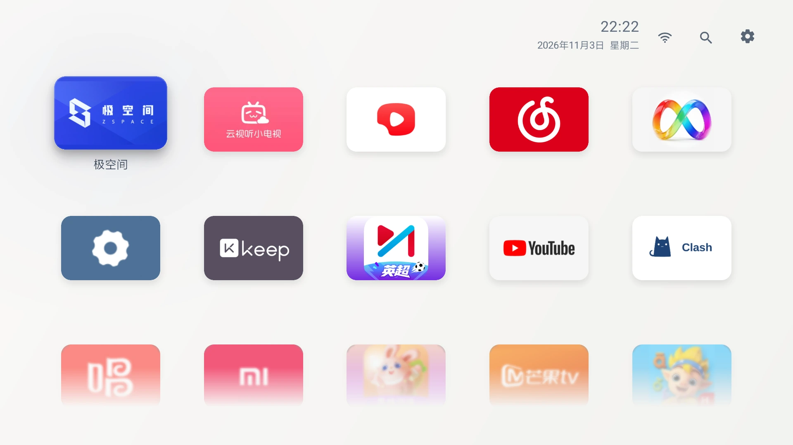
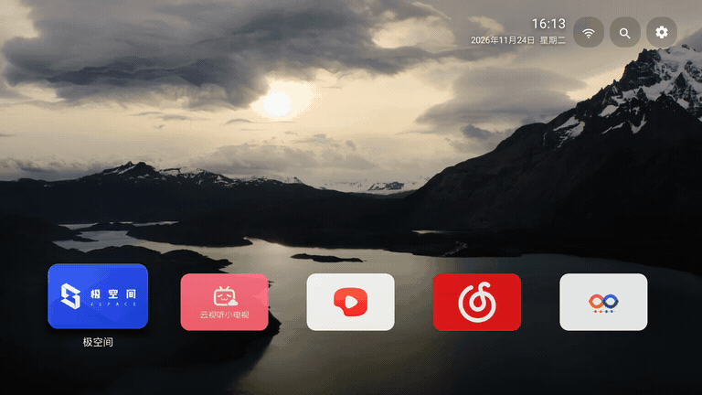
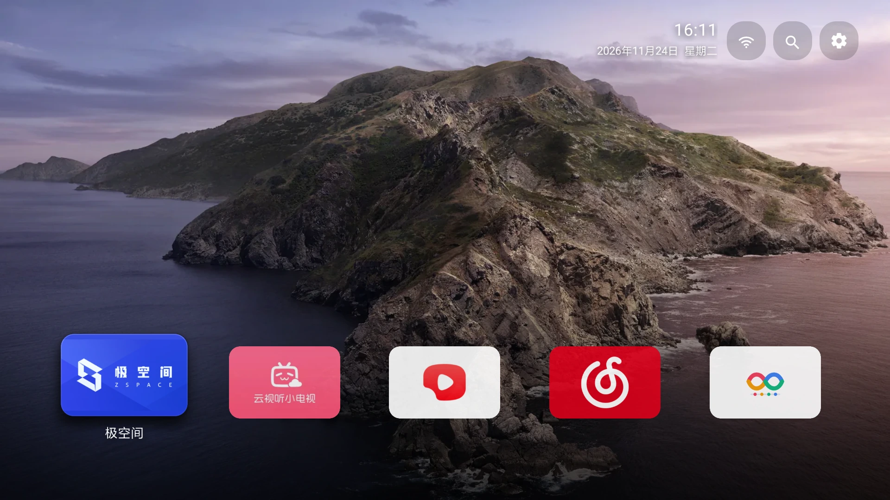
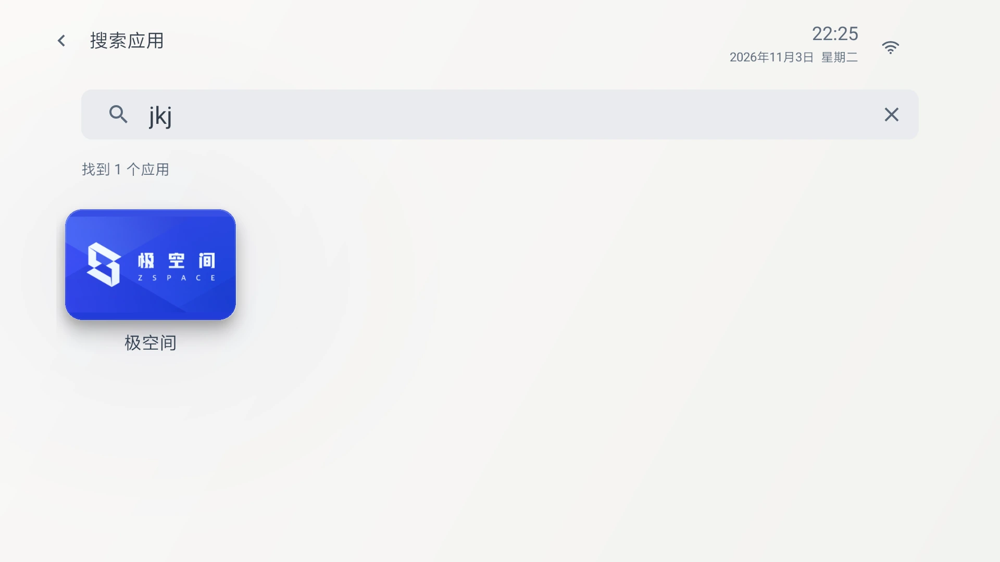
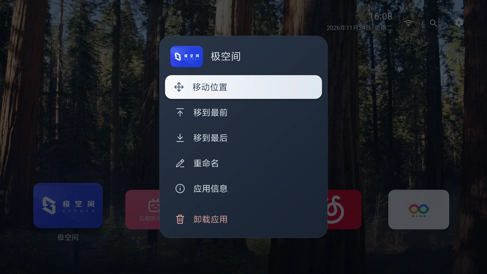
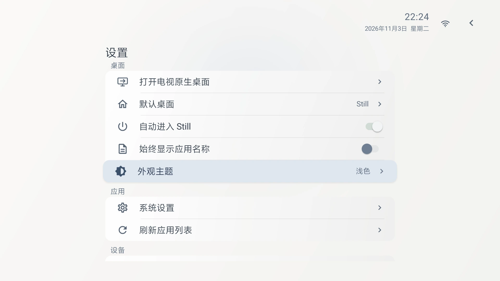

<p align="center">
  
</p>

<h1 align="center">Still</h1>
<p align="center">Room for what matters</p>
<p align="center">原生 Android 电视桌面 · 遥控器优先 · 图标联动环境光</p>
<p align="center"><a href="https://mfcheer.github.io/luma/">访问 Still 官网</a> · <a href="https://mfcheer.github.io/luma/#film">观看实机演示</a> · <a href="https://mfcheer.github.io/luma/downloads/Still-0.9.19.apk">下载预览版</a></p>

Still 是一个简洁的 Android 电视桌面应用。首页自动展示所有可启动的应用，支持手动调整顺序；选中图标时，周围的环境光会随应用主色柔和变化。没有内容推荐流、广告 SDK 或统计服务；日常运行不产生后台网络请求，仅在设置中由用户主动点击“检查更新”时联网下载安装包并请求系统安装。

当前公开下载：**0.9.19 预览版**。首页和搜索默认仅在选中时显示应用名称，统一卡片浮起、柔和阴影、滚动渐隐与焦点附近的环境光；快速连续切换更利落。设置可选择始终显示名称。小米电视 5 Pro 55 英寸 / Android 9（API 28）上的新版截图与录屏见下文；开机自动进入和长期待机恢复仍需分别验证。

最新版本 **0.9.19**：桌面静置默认 1 分钟自动进入纯壁纸屏保，限时 15 分钟保持亮屏以跨过系统屏保节点并在到期或按键时自动释放交还休眠；设置页新增「桌面屏保」等待时长（30 秒 / 1 分钟 / 2 分钟 / 关闭）；「外观与壁纸」和「桌面屏保」均精简为纯 `< 值 >` 左右切换，去掉确认反馈与详情画廊/预览跳转。官网同步提供 0.9.19 安装包与校验清单。

此前 **0.9.18**：外观与壁纸行内微缩视窗，设置面板「外观与壁纸」项新增 16:9 圆角缩略图与高光轮廓，焦点停留时支持遥控器左右键快速切切看与轻量即时联动；沉浸式壁纸画廊，按确定键唤起横向壁纸卡片流（9 款主题完整覆盖），1.08 倍获焦放大与珍珠白高光描边，遥控切换时大屏背景实时铺开 1080P 原图试穿，所见即所得；防抖与内存防线，内置 100ms 滑动防抖，画廊卡片流采用 384×216 独立轻量缩略图杜绝多图并发 OOM，返回键无痕回滚原壁纸并精准复位焦点。

此前 **0.9.17**：隔空安装助手体验重构，彻底修复弹窗关闭按钮右侧截断与获焦生硬亮边，升级为温润珠白高对比质感；首屏加载防抖重构，应用目录与内置卡片合并一次性渲染，彻底消除启动与切回桌面时的末行跳动与视口颠簸；核心功能常驻，设置面板精简，隔空安装作为系统级特性默认常驻首页应用墙。

此前 **0.9.16**：新增 3 套顶级摄影级自然风光大片（巴塔哥尼亚雪峰、加州红杉晨曦、优胜美地苍谷），壁纸库扩展至 7 款自然风景 + 2 款经典纯色，支持外观与壁纸无缝左右轮播；全天候高对比度文字自适应，统一暗场基座与立体阴影，多段非线性底部暗罩确保复杂风景与高亮天空下字字清晰锐利；顶部操作图标加装微透圆角暗盾（Dark Scrim），强光天际线下轮廓清晰稳固。官网同步提供 0.9.16 安装包、真机演示录屏与校验清单。

此前 **0.9.15**：修复应用冷启动及从第三方应用返回时，列表偶发异常跳转至末行再弹回首行的焦点晃动问题；优化首页应用墙渲染稳定性，相同列表跳过冗余重建，装载卡片期间阻断子视图抢焦；加固顶部操作栏焦点链路。

**0.9.14 更新**：新增「局域网极速快传与隔空安装助手（Air Install）」，支持同一局域网下手机扫码或电脑免拷 U 盘极速向电视推送安装 APK；用完即毁原生 HTTP 流式直存服务，杜绝 OOM；三段式大屏状态机与 Apple tvOS 质感全圆角胶囊双按钮体系；首页卡片复用 Apple iOS AirDrop 官方同心圆弧矢量图标。

**0.9.13 更新**：网页快捷方式支持标题自动提取与三阶段校准（失焦预填、后台 HTML 同步解析、WebView 实时回写）；新增编程状态屏专属高清透明矢量 Logo；引入外部图标智能融底消边算法，完美消除白底卡片边缘冲突。

**0.9.10 更新**：外观主题改为一键切换，与“始终显示名称”使用相同的开关交互；切换后焦点留在原项，选择自动保存。

**0.9.9 更新**：完善手动在线更新闭环，离开窗口后继续下载，安装授权、取消安装或重启后恢复有效安装包；安装前重新校验完整性、包名、版本和签名，以实际运行版本确认升级成功。本地自动验证通过，电视实机升级验收仍待完成，详见[0.9.9 验证记录](docs/qa-099/README.md)。

此前 **0.9.7**：首页和搜索长按菜单新增“重命名”“卸载应用”。自定义名称仅在Still本地显示，支持恢复原名，新名称、原名和已有别名均可搜索；卸载交给系统确认，预装系统应用不提供直接卸载，确认移除后清理相关名称和记录并选择相邻应用。新增普通的请求卸载权限，不申请静默卸载权限。开发与验证见[0.9.7记录](docs/qa-097/README.md)。

此前 **0.9.6**：首页和搜索结果长按菜单新增“移到最后”，将不常用的应用排到首页末尾，其他应用保持相对顺序；调整立即保存，重复执行不产生重复项。搜索保留关键词和选中应用，返回首页定位到调整后的应用。浅深主题已在模拟器验证，并已覆盖安装到小米Android9电视，保留原顺序、选项、使用记录和默认桌面；安装期间保持息屏，未进行实机菜单交互测试。验证见[0.9.6记录](docs/qa-096/README.md)。

此前 **0.9.5**（已覆盖安装到小米电视）：设置页新增“打开电视原生桌面”，单个入口直接打开，多个入口首次选择并记住；目标失效后重新选择。临时打开不更改默认桌面或自动进入开关，主动切换会取消当前待执行的唤醒返回请求；兼容受限HOME组件的同包公开别名入口。验证见 [0.9.5记录](docs/qa-095/README.md)。

此前 **0.9.4**（已覆盖安装到小米电视）：搜索内置已核实应用的别名、全拼与首字母，修正“音乐”等读音；先按匹配准确度，再按近期使用频次排序，同档仍以首页顺序兜底。从搜索打开应用再返回或后台进程重建，保留结果与焦点；不增加选项，不改变首页排列，也不申请新权限。词库覆盖和本轮验证见 [0.9.4记录](docs/qa-094/README.md)。

此前 **0.9.3**：将开机与待机唤醒合并为“自动进入 Still”开关，沿用已有开机设置；Android 6–9 增加按事件运行的唤醒监听，较新系统暂仅保留开机尝试。实机结果与限制见 [0.9.3验证](docs/qa-093/README.md)。

## 近期更新

| 版本 | 主要变化 |
| --- | --- |
| **0.9.19（当前）** | 新增桌面纯壁纸屏保（默认静置 1 分钟进入，限时 15 分钟亮屏保护并自动交还系统休眠）；设置页「外观与壁纸」与「桌面屏保」改为纯左右切换（`< 值 >`），去掉确认反馈与画廊/预览跳转。 |
| 0.9.18 | 主题外观行内微缩视窗（16:9 缩略图与高光轮廓，左右键快速切切看）；沉浸式壁纸画廊（按 OK 唤起 9 款横向卡片流，1080P 全屏大图实时试穿）；内置 100ms 滑动防抖与 384×216 独立轻量切片防 OOM，返回键无痕回滚原壁纸。 |
| 0.9.17 | 隔空安装助手体验重构（修复按钮截断与白边）；首屏加载防抖与时序重构，根除末行跳动；设置精简，隔空安装默认常驻。 |
| 0.9.16 | 扩充 3 款自然风光大片（巴塔哥尼亚雪峰/加州红杉/优胜美地）与外观壁纸轮播；全天候高对比自适应文字与立体暗影；顶部状态图标微透悬浮暗盾。 |
| 0.9.15 | 修复冷启动与应用返回时列表跳至末行再弹回首行的焦点晃动，相同列表避免重复布局与装载期间防抢焦，顶部栏焦点链路加固。 |
| 0.9.14 | 局域网隔空安装助手（Air Install）、流式直存零驻留服务、三段式大屏状态机与 Apple AirDrop 官方矢量图标。 |
| 0.9.13 | 网页标题自动提取校准（三阶段递进）、状态屏专属透明矢量 Logo 与外部图标智能融底消边。 |
| 0.9.12 | 网页快捷方式采用纯白极简卡片视觉，纯粹呈现原始高清图标；去除冗余渐变与角标修饰。 |
| 0.9.11 | 支持网页快捷方式、手机局域网扫码配网、独立轻量浏览进程与主流站点高清 Logo / Favicon 自动抓取。 |
| 0.9.10 | 外观主题改为开关，按确定直接切换浅色／深色，保留焦点并保存选择。 |
| 0.9.9 | 在线更新支持窗口退出后继续下载、恢复安装、安装前重新校验和实际版本确认；完善失败恢复提示。 |
| 0.9.8 | 设置页手动检查在线更新、直接下载并进入系统安装确认；HTTPS限制、SHA-256与开发签名双重校验，下载进度展示及失败重试。 |
| 0.9.7 | 长按重命名与系统确认卸载；原名/新名/别名搜索、恢复原名、系统应用保护及卸载后的相邻焦点。 |
| 0.9.6 | 首页与搜索结果长按新增“移到最后”，保留其他应用相对顺序、搜索关键词和选中应用。 |
| 0.9.5 | 设置页直接打开电视原生桌面，记忆其他桌面入口，处理入口失效与待执行的唤醒返回。 |
| 0.9.4 | 离线别名与拼音纠音、最佳命中去重、同档近期使用频次；冻结搜索次序和焦点，卸载清理本地频次。 |
| 0.9.3 | 统一开机/唤醒开关；Android 6–9 唤醒后单次返回首页，关闭即停止监听，增加唤醒诊断记录。 |
| 0.9.2 | 首页和搜索共用仅选中显示名称、14%放大与克制落点；快速导航减少回弹，固定上下渐隐边界，背景只响应停留的应用。 |
| 0.9.1 | 搜索结果长按菜单：移到最前、在首页定位、应用信息；保留查询与焦点，恢复后继续同步首页。 |
| 0.9.0 | 本地应用搜索、拼音首字母匹配、系统输入法适配，保留搜索和首页各自的焦点/位置；统一搜索与设置图标对齐。 |
| 0.8.3 | 长按菜单新增“移到最前”，保留原有移动位置和应用信息操作；重复置前不改变其他顺序。 |
| 0.8.2 | 首页向下浏览后按返回键快速回到第一行；已在首行则保留选择，菜单关闭、整理撤销与设置返回仍优先处理。 |
| 0.8.1 | 应用目录与图标增加内存/磁盘缓存，正常返回复用首页；默认桌面新增状态面板、系统设置和其他桌面入口；修复上下滚动跨行时顶部图标闪亮。 |
| 0.8.0 | 默认珍珠白浅色主题；设置可即时切换浅色/深色并记住选择，首页、菜单和设置统一适配。 |
| 0.7.2 | 时钟与设置入口统一；柔光跟随焦点位置，快速切换更紧凑；长按菜单精简，整理卡片增加“移动中”，边界预览减轻模糊。 |
| 0.7.1 | 全新蓝色 S 标识，统一方形图标、Android 自适应图标和 TV 横版应用卡片；覆盖升级保留顺序及设置。 |
| 0.7.0 | 首页自动展示全部可启动应用，取消收藏和独立的“全部应用”面板；长按仅保留移动位置、应用信息。 |
| 0.6.3 | 加强选中卡片的放大、抬起和阻尼回弹，修正滚动边界裁切。 |
| 0.6.2 | 更新焦点反馈与长按操作面板。 |
| 0.6.1 | 设置新增“显示应用名称”开关，支持纯图标首页。 |

## 实机预览

以下截图、演示视频和动图为 **Still 0.9.7 开发版**，于2026年11月3日直接从小米电视 5 Pro 55 英寸 / Android 9 采集，系统界面为1920×1080，设备有42个可启动应用。画面中的网络标识尚未进入官网提供的下载包。图标来自设备实际安装的应用，不是设计稿或测试应用。截图不包含家庭环境或网络设置。



### 遥控器交互



[观看完整实机视频（MP4）](website/assets/still-tv-demo.mp4) · [查看滚动后的应用墙](website/assets/scrolled-light.webp)

演示包含浅深主题的焦点切换、连续导航、上下滚动、返回首行，以及搜索结果长按菜单。画面经过片段整理与网页压缩，播放速度保持原速；录制链路不代表电视面板刷新率。所有第三方应用的标识属于对应权利人，不随 Still 安装包提供。

### 浅色与深色

默认珍珠白，焦点附近保留轻微主色染色与柔和阴影。在「设置 → 外观主题」中选择浅色或深色，立即生效并记住选择。



### 应用搜索

输入名称或拼音首字母，即时筛选设备上的应用；结果页也支持长按菜单。



### 长按与设置

长按确定打开应用菜单，可调整顺序、重命名、查看应用信息或卸载；整理时方向键调整、确定保存、返回撤销。名称开关为“始终显示应用名称”：关闭时仅选中显示，开启时全部显示；图标素材自带的文字不受影响。

| 长按菜单 | 分组设置 |
| --- | --- |
|  |  |

[下载 Still 0.9.19 预览 APK](website/downloads/Still-0.9.19.apk) · [校验和](website/downloads/SHA256SUMS.txt) · [安装说明](docs/安装与电视验证.md)

同签名覆盖安装可保留顺序与设置。本次预览包使用开发调试签名，仅在手动检查与下载更新时使用联网与安装权限，不包含任何广告或统计 SDK。

## 功能

- **隔空安装助手（0.9.14）**：首页提供专属「隔空安装」卡片，纯白底板搭配标志性天蓝环境光与 Apple iOS AirDrop 官方矢量图标。按确定键即拉起大屏弹窗与动态 HTTP 服务，局域网内手机扫码或电脑浏览器拖拽 APK 极速上传；采用 8KB 分块缓冲区流式直写磁盘（防 OOM 且预检剩余空间）；APK 上传完成后原生解析高清图标、版本与体积，遥控器焦点自动落入「立即安装」胶囊主按钮，完成系统安装闭环；弹窗关闭即刻释放端口与线程，日常 0 驻留。
- **本地应用搜索**：首页右上角进入，支持名称、英文、拼音、首字母；0.9.4内置已核实应用的常用别名（如B站、油管）及多音字纠正。每个应用只显示最佳命中，准确度优先，同档参考近期从Still打开的频次；首页排列保持手动顺序。无记录时按首页顺序兜底，不增加设置项，不联网、不上传输入或使用数据。
- **浅色与深色主题**：默认珍珠白，设置中手动选择并保存；主题覆盖首页、时钟、焦点、分组设置、长按菜单与原生对话框。
- **舒展的应用墙**：五列横向卡片，上下左右连续导航，两行清晰内容与下方淡化、模糊的续行；焦点进入后滚到清晰区域。
- **返回首行**：首页向下浏览后按返回键，滚回顶部并选中第一个应用；已经在第一行时保留当前选择。菜单关闭、整理撤销和设置返回优先处理。
- **快速恢复首页**：正常从其他应用返回时保留现有页面；进程重启优先恢复本地目录、图标和预览，再后台核对应用变化。仅更新受影响的应用，缓存丢失或损坏可重新生成，顺序和设置独立保存。
- **自动展示全部应用**：无需收藏或手动添加，读取所有可启动的电视和普通应用，同包优先电视入口；不展示没有启动入口的后台组件。
- **按焦点显示名称**：首页与搜索结果默认仅显示选中应用的居中名称；焦点回到顶部或搜索框后隐藏。设置可选择始终显示，保留已有明确设置、无障碍名称和应用菜单名称；名称变化不改变行距，整理时显示临时“移动中”标识。
- **在线更新（0.9.8）**：设置页提供手动“检查更新”入口，遥控器一键直达；发现新版展示详细说明与包体大小，就地下载并实时展示进度条与百分比。下载完成后严格校验 SHA-256 与开发签名一致性，通过轻量级原生 FileProvider 调起系统安装确认，Android 8+ 引导未知应用安装授权后自动继续；杜绝拔插 U 盘，不后台静默检查。
- **重命名应用（0.9.7）**：首页和搜索长按输入本地显示名称，支持恢复原名；保存后同步卡片、菜单和无障碍名称。保留原名、已有别名及拼音搜索，不改变手动排序或使用频次，也不修改系统中的应用名称。名称独立于图标缓存保存，随应用升级保留，卸载后清理。
- **卸载应用（0.9.7）**：长按菜单底部进入系统卸载确认，不额外重复确认；取消保留原应用和位置，真正卸载后同步首页与搜索、清理名称与使用记录并选中相邻项。系统应用禁用此入口，仍可通过应用信息查看系统提供的操作。
- **真实 TV 素材**：优先使用应用自己的横幅，缺失时等比适配原图标；保留真实标识，不内置概念图中的视频应用。
- **焦点与按下反馈**：选中卡片约1.14倍放大，首页和搜索使用一致的上浮幅度；单次切换有克制的落点，下方柔和阴影强调浮起。快速切换缩短至120毫秒并取消回弹，中途经过的名称延后显示；确定键轻压后释放，返回恢复应用和滚动位置。
- **连续滚动与模糊预览**：半行预览提示还有应用，顶部部分内容也会淡化；以渐隐为主、轻度模糊保留轮廓，不显示位置条。模糊素材预先缓存，兼容 Android 9，不依赖 RenderEffect。
- **首页长按整理**：圆角面板展示应用缩略图，提供“移动位置”“移到最前”和“应用信息”；0.9.6新增“移到最后”，首页与搜索结果均可使用。置前或置后立即保存，其余应用保持相对顺序；方向键调整，确定保存，返回撤销，相邻卡片平移让位；被移动卡片有独立抬起与细边状态，名称位置显示“移动中”。
- **顺序自动维护**：保留手动顺序，新安装的应用追加到末尾，卸载后自动移除，应用更新保持原位置；旧版本收藏迁移成顺序前缀，再补齐其余应用。
- **联动环境光**：局部、低饱和度柔光跟随焦点位置与图标主色；短暂经过应用时不立即变色，停留后颜色与位置一起平滑跟进，滚动和整理时跟随卡片，空闲时停止动画。
- **时间与日期**：右上角两行显示时间、年月日和中文星期，跟随设备本地时间刷新。
- **分组设置**：桌面、应用、设备三组共七项；焦点轻微浮起，开机开关直接保存且保持焦点。
- **设备信息**：查看 Android/API 版本、处理器架构、默认桌面及启动检测记录。
- **桌面与开机实验**：默认桌面显示当前检测状态，可打开系统桌面设置或临时进入其他可用桌面；系统选择页不可见时给出提示。“自动进入 Still”统一控制开机与支持系统上的待机唤醒，默认关闭。

Still 本身不提供视频、直播源、音乐或其他第三方应用内容。

## 开发环境

| 项目 | 配置 |
| --- | --- |
| 开发语言 / UI | Java / 原生 Android Views |
| 最低系统 | Android 6.0，API 23 |
| compileSdk / targetSdk | 35 / 35 |
| Android Gradle Plugin | 8.7.3 |
| Gradle Wrapper | 8.10.2 |
| JDK | 17 或 21（已使用 21 验证） |
| 应用包名 | `com.jianping.tv` |

包名保留早期版本的命名，以便同签名覆盖升级并继承现有排序和设置。项目没有原生二进制依赖，不限定 ARM 32/64 位架构。

## 本地构建

1. 克隆仓库：

   ```sh
   git clone git@github.com:mfcheer/luma.git
   cd luma
   ```

2. 通过 Android Studio / SDK Manager 安装 Android SDK Platform 35 和 Build Tools 35.0.0。

3. 在项目根目录创建 `local.properties`，将下方路径替换为本机实际 SDK 路径：

   ```properties
   sdk.dir=/absolute/path/to/Android/sdk
   ```

   也可以直接使用 Android Studio 打开工程，由 IDE 配置 SDK 路径。`local.properties` 不提交到仓库。

4. 构建并运行静态检查：

   ```sh
   ./gradlew :app:assembleDebug :app:lintDebug
   ```

   Windows 使用 `gradlew.bat` 执行相同任务。

普通构建产物位置：`app/build/outputs/apk/debug/app-debug.apk`，构建目录不提交。官网的 `website/downloads/` 单独提供已核对的 0.9.19 预览 APK 及校验和；Gradle 缓存和签名密钥不提交。

## 安装与使用

可以通过电视支持的 U 盘安装入口安装 APK，也可以在开启调试并授权连接后使用 ADB：

```sh
adb connect <电视显示的地址和端口>
adb install --no-incremental -r app/build/outputs/apk/debug/app-debug.apk
adb shell am start -n com.jianping.tv/.ui.MainActivity
```

部分固件使用无线配对和动态端口，请以电视显示的信息为准。
