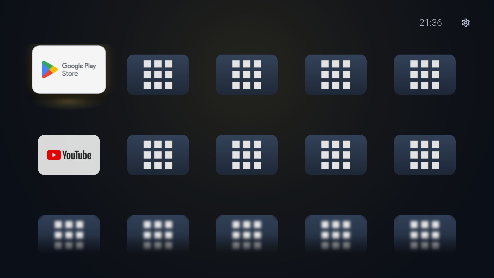
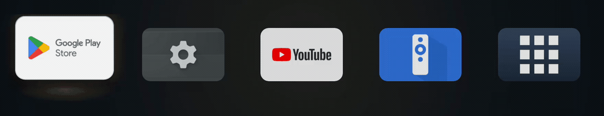
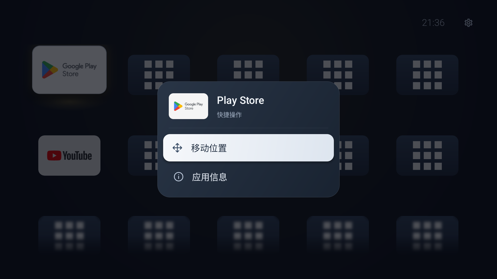
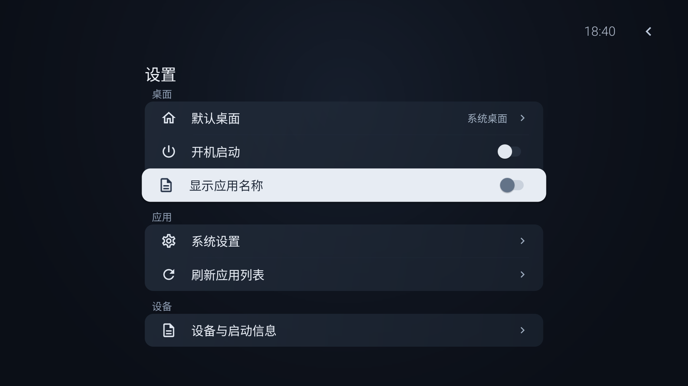

<p align="center">
  
</p>

<h1 align="center">Still</h1>
<p align="center">A quiet home for your TV.</p>
<p align="center">原生 Android 电视桌面 · 遥控器优先 · 图标联动环境光</p>

Still 是一个简洁的 Android 电视桌面应用。首页自动展示所有可启动的应用，支持手动调整顺序；选中图标时，周围的环境光会随应用主色柔和变化。没有内容推荐流、广告 SDK 或统计服务，也不申请联网权限。

当前版本：**0.7.1**。目标适配设备为小米电视 5 Pro 55 英寸，用户已确认 Android 9.0（API 28）；目前已完成 Android TV API 33 模拟器验证，尚未完成该型号的实机适配验证。

## 预览

以下为 Android TV 模拟器实际截图。画面中的“测试应用”仅用于验证较多应用时的布局，不包含在 Still 安装包中。应用图标读取自设备，外观取决于已安装应用。



在「设置 → 桌面 → 显示应用名称」关闭名称后，首页只显示图标，间距和焦点反馈保持不变。选择会自动保存；默认开启。图标素材中自带的文字不受开关影响，长按菜单仍显示应用名称。







## 功能

- **舒展的应用墙**：五列横向卡片，上下左右连续导航，两行清晰内容与下方淡化、模糊的续行；焦点进入后滚到清晰区域。
- **自动展示全部应用**：无需收藏或手动添加，读取所有可启动的电视和普通应用，同包优先电视入口；不展示没有启动入口的后台组件。
- **可选纯图标首页**：设置中隐藏首页应用名称；保留无障碍名称与应用菜单名称，重启后记住选择。
- **真实 TV 素材**：优先使用应用自己的横幅，缺失时等比适配原图标；保留真实标识，不内置概念图中的视频应用。
- **焦点与按下反馈**：选中卡片约1.2倍放大、上浮10逻辑像素，伴随短促的阻尼回弹和独立下方柔光；未选中卡片略暗，层次更清楚。快速切换从当前状态接续，确定键轻压后释放，返回恢复应用和滚动位置。
- **连续滚动与模糊预览**：半行预览提示还有应用，顶部部分内容也会淡化；模糊素材预先缓存，兼容 Android 9，不依赖 RenderEffect。
- **长按整理**：圆角面板展示应用缩略图，提供“移动位置”和“应用信息”；方向键调整，确定保存，返回撤销，相邻卡片平移让位。
- **顺序自动维护**：保留手动顺序，新安装的应用追加到末尾，卸载后自动移除，应用更新保持原位置；旧版本收藏迁移成顺序前缀，再补齐其余应用。
- **联动环境光**：背景低亮度随图标主色平滑过渡；卡片附近保留局部高光，空闲时停止动画。
- **分组设置**：桌面、应用、设备三组；浅色焦点轻微浮起，开机开关直接保存且保持焦点。
- **应用发现**：读取已安装应用，优先使用 TV 启动入口，同一应用按包去重。
- **排序持久化**：本地保存，版本升级和重启应用后保留。
- **设备信息**：查看 Android/API 版本、处理器架构、默认桌面及启动检测记录。
- **桌面与开机实验**：提供系统默认桌面设置入口，以及默认关闭的开机启动实验。

Still 本身不提供视频、直播源、音乐或其他第三方应用内容。

## 开发环境

| 项目 | 配置 |
| --- | --- |
| 开发语言 / UI | Java / 原生 Android Views |
| 最低系统 | Android 6.0，API 23 |
| compileSdk / targetSdk | 35 / 35 |
| Android Gradle Plugin | 8.7.3 |
| Gradle Wrapper | 8.10.2 |
| JDK | 17 或 21（已使用 21 验证） |
| 应用包名 | `com.jianping.tv` |

包名保留早期版本的命名，以便同签名覆盖升级并继承现有排序和设置。项目没有原生二进制依赖，不限定 ARM 32/64 位架构。

## 本地构建

1. 克隆仓库：

   ```sh
   git clone git@github.com:mfcheer/luma.git
   cd luma
   ```

2. 通过 Android Studio / SDK Manager 安装 Android SDK Platform 35 和 Build Tools 35.0.0。

3. 在项目根目录创建 `local.properties`，将下方路径替换为本机实际 SDK 路径：

   ```properties
   sdk.dir=/absolute/path/to/Android/sdk
   ```

   也可以直接使用 Android Studio 打开工程，由 IDE 配置 SDK 路径。`local.properties` 不提交到仓库。

4. 构建并运行静态检查：

   ```sh
   ./gradlew :app:assembleDebug :app:lintDebug
   ```

   Windows 使用 `gradlew.bat` 执行相同任务。

产物位置：`app/build/outputs/apk/debug/app-debug.apk`。仓库不包含本机生成的 APK、Gradle 缓存或签名密钥。

## 安装与使用

可以通过电视支持的 U 盘安装入口安装 APK，也可以在开启调试并授权连接后使用 ADB：

```sh
adb connect <电视显示的地址和端口>
adb install -r app/build/outputs/apk/debug/app-debug.apk
adb shell am start -n com.jianping.tv/.ui.MainActivity
```

部分固件使用无线配对和动态端口，请以电视显示的信息为准。

| 操作 | 行为 |
| --- | --- |
| 方向键 | 移动焦点；整理模式中调整位置 |
| 确定 | 打开应用；整理模式中保存顺序 |
| 长按确定 | 打开应用操作菜单 |
| 返回 | 关闭浮层；整理模式中撤销；设置返回首页 |
| Home | 由系统当前默认桌面决定 |

同一签名的后续 APK 可以覆盖升级。不同电脑生成的默认调试密钥可能不同；若需要持续分发，请自行配置并妥善保管固定签名密钥。

## 开机与默认桌面的限制

声明为桌面应用、收到开机通知，以及系统命令返回成功，均不等于系统允许它接管 Home 或开机画面。Still 分开记录开机通知、启动请求与界面进入情况，便于实机确认。

目前的 Android TV API 33 模拟器测试中，设置默认桌面的命令曾返回成功，但 Home 仍进入系统桌面。因此 **MiTV OS 2.17.3226 上的开机自动进入、Home 接管和待机唤醒仍需实机验证**。应用不会禁用原厂桌面，也不会移除系统或第三方应用内部的广告。

更详细的安装、恢复与验证步骤见 [安装与电视验证](docs/安装与电视验证.md)。

## 项目结构

```text
app/src/main/java/com/jianping/tv/
├── data/                      应用发现、应用模型、顺序同步与设置持久化
├── platform/                  开机广播、设备与默认桌面检测
└── ui/
    ├── MainActivity.java      页面、浮层、整理事务与导航
    ├── AppActionMenuView.java 应用菜单、焦点隔离与展开/收起
    ├── AppCardView.java       焦点浮起、按下和模糊预览
    ├── GridWallView.java      五列连续滚动与稳定卡片排序
    ├── AmbientBackgroundView.java  主色联动环境光
    ├── IconPalette.java       图标主色采样
    ├── IconArtwork.java       图标内容识别与统一呈现
    └── SettingsRowView.java   可复用分组设置行与开关
```

底层应用管理、顺序同步和设备检测与 UI 分开，后续可以继续扩展主题、布局与设置。详见 [设计与架构](docs/设计与架构.md)。

## 验证

验证覆盖 APK 构建和 Android Lint、独立顺序同步检查，以及 Android TV API 33 ARM64 模拟器上的28个应用、全量展示、迁移、排序保存/撤销、包变化和启动返回。

`scripts/` 中的模拟器脚本使用开发机 SDK 路径和专用 `emulator-5554`，需要24个测试应用。**脚本会临时替换偏好和安装/卸载测试应用，请勿用于个人电视。** 测试应用不打包进 Still。

- `AppOrderTest.java`：纯 Java 顺序同步验证，覆盖首次展示、旧顺序前缀、增删、去重、入口类变化和重复刷新稳定性，无需 Android 运行时。
- `all-apps-070-smoke.py`：0.7 全量首页、旧版迁移、取消/保存/重启排序、真实包更新/卸载/安装、整理期间的包变化、隐藏名称和应用启动/信息返回；结束恢复偏好和测试应用。
- 其他包含收藏、应用面板或旧导航路径的脚本保留作0.6及更早版本的历史记录，不适用于0.7的产品流程。

详细记录见 [验证记录](docs/验证记录.md)。

## 素材与第三方说明

应用标识由内置 ImageGen 生成，当前采用用户选择的蓝色 S；包含旧系统图标、多密度与 API26+ 自适应图标、TV 横幅。原始方案与完整提示词见 [图标设计记录](docs/designs/icon-refresh/README.md)。界面运行时显示的其他应用图标来自设备上已安装的应用，版权属于对应所有者。部分设置图标使用 Apache-2.0 授权的 Google Material Design Icons，详见 [第三方说明](THIRD_PARTY_NOTICES.md) 和 [图标许可证](docs/material-icons-LICENSE.txt)。
