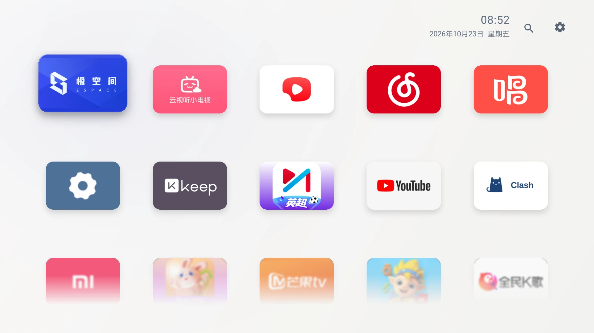
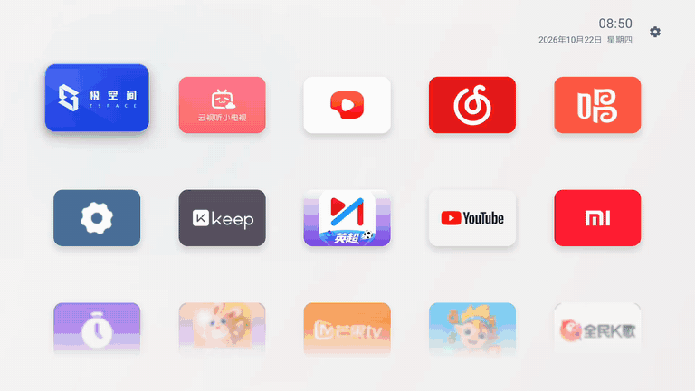
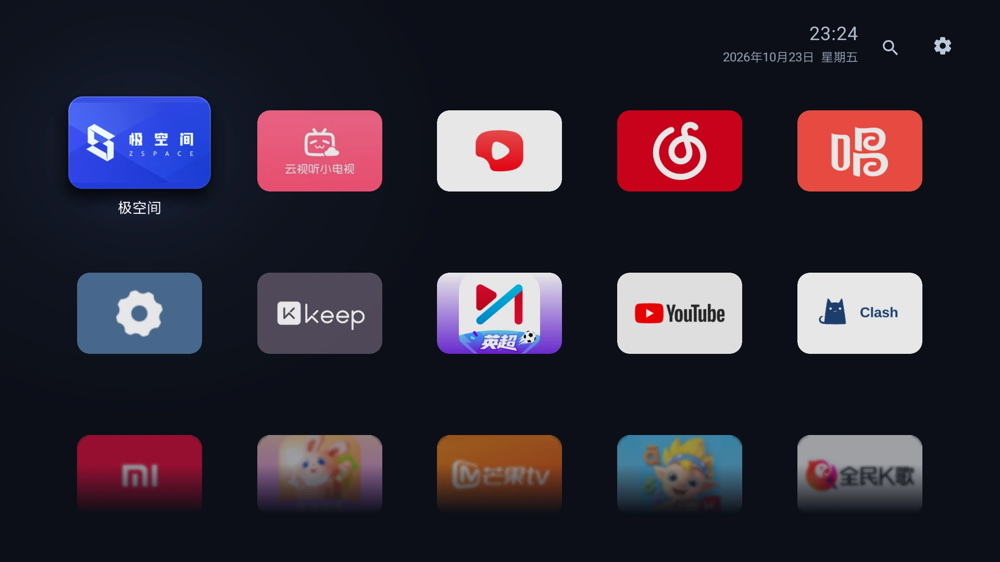
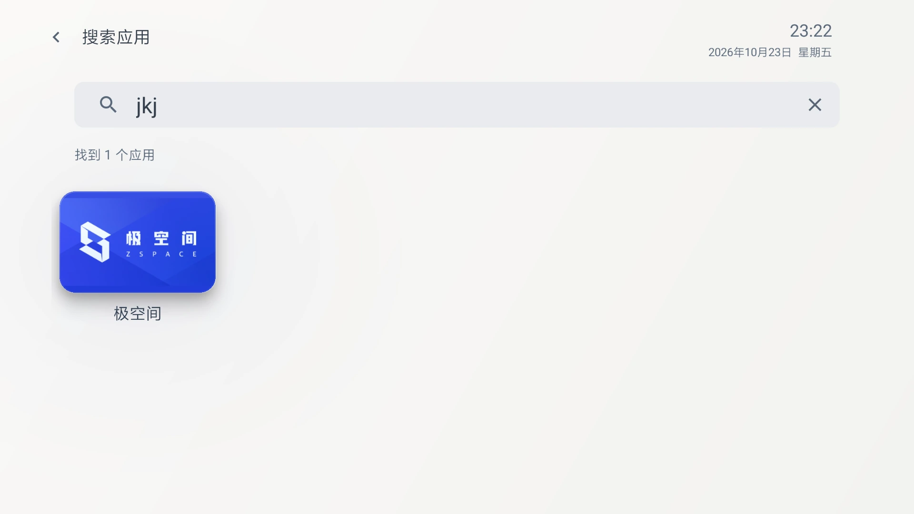
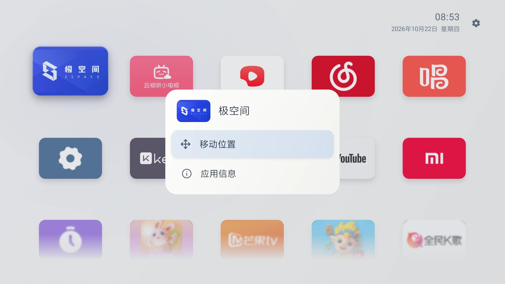
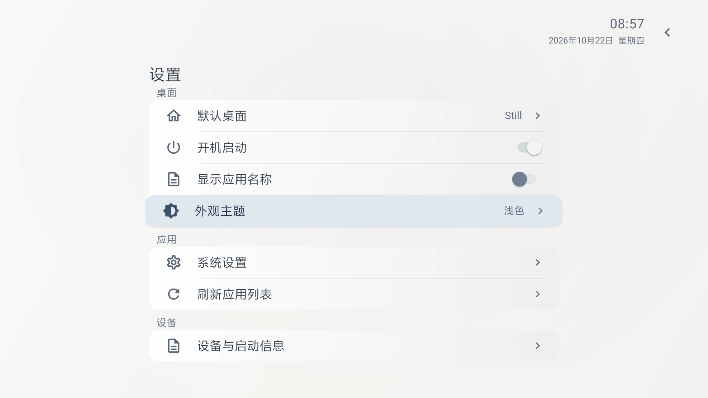

<p align="center">
  
</p>

<h1 align="center">Still</h1>
<p align="center">Room for what matters</p>
<p align="center">原生 Android 电视桌面 · 遥控器优先 · 图标联动环境光</p>
<p align="center"><a href="https://mfcheer.github.io/luma/">访问 Still 官网</a> · <a href="https://mfcheer.github.io/luma/#film">观看实机演示</a> · <a href="https://mfcheer.github.io/luma/downloads/Still-0.9.7.apk">下载预览版</a></p>

Still 是一个简洁的 Android 电视桌面应用。首页自动展示所有可启动的应用，支持手动调整顺序；选中图标时，周围的环境光会随应用主色柔和变化。没有内容推荐流、广告 SDK 或统计服务，也不申请联网权限。

当前公开下载：**0.9.7 预览版**。首页和搜索默认仅在选中时显示应用名称，统一卡片浮起、柔和阴影、滚动渐隐与焦点附近的环境光；快速连续切换更利落。设置可选择始终显示名称。小米电视 5 Pro 55 英寸 / Android 9（API 28）上的新版截图与录屏见下文；开机自动进入和长期待机恢复仍需分别验证。

最新版本 **0.9.7**：首页和搜索长按菜单新增“重命名”“卸载应用”。自定义名称仅在Still本地显示，支持恢复原名，新名称、原名和已有别名均可搜索；卸载交给系统确认，预装系统应用不提供直接卸载，确认移除后清理相关名称和记录并选择相邻应用。新增普通的请求卸载权限，不申请联网或静默卸载权限。本轮使用专用模拟器验证，电视仍为0.9.6；官网提供0.9.7安装包，实机截图与视频保留0.9.2。开发与验证见[0.9.7记录](docs/qa-097/README.md)。

此前 **0.9.6**：首页和搜索结果长按菜单新增“移到最后”，将不常用的应用排到首页末尾，其他应用保持相对顺序；调整立即保存，重复执行不产生重复项。搜索保留关键词和选中应用，返回首页定位到调整后的应用。浅深主题已在模拟器验证，并已覆盖安装到小米Android9电视，保留原顺序、选项、使用记录和默认桌面；安装期间保持息屏，未进行实机菜单交互测试。验证见[0.9.6记录](docs/qa-096/README.md)。

此前 **0.9.5**（已覆盖安装到小米电视）：设置页新增“打开电视原生桌面”，单个入口直接打开，多个入口首次选择并记住；目标失效后重新选择。临时打开不更改默认桌面或自动进入开关，主动切换会取消当前待执行的唤醒返回请求；兼容受限HOME组件的同包公开别名入口。验证见 [0.9.5记录](docs/qa-095/README.md)。

此前 **0.9.4**（已覆盖安装到小米电视）：搜索内置已核实应用的别名、全拼与首字母，修正“音乐”等读音；先按匹配准确度，再按近期使用频次排序，同档仍以首页顺序兜底。从搜索打开应用再返回或后台进程重建，保留结果与焦点；不增加选项，不改变首页排列，也不申请新权限。词库覆盖和本轮验证见 [0.9.4记录](docs/qa-094/README.md)。

此前 **0.9.3**：将开机与待机唤醒合并为“自动进入 Still”开关，沿用已有开机设置；Android 6–9 增加按事件运行的唤醒监听，较新系统暂仅保留开机尝试。实机结果与限制见 [0.9.3验证](docs/qa-093/README.md)。

## 近期更新

| 版本 | 主要变化 |
| --- | --- |
| **0.9.7（当前）** | 长按重命名与系统确认卸载；原名/新名/别名搜索、恢复原名、系统应用保护及卸载后的相邻焦点。 |
| 0.9.6 | 首页与搜索结果长按新增“移到最后”，保留其他应用相对顺序、搜索关键词和选中应用。 |
| 0.9.5 | 设置页直接打开电视原生桌面，记忆其他桌面入口，处理入口失效与待执行的唤醒返回。 |
| 0.9.4 | 离线别名与拼音纠音、最佳命中去重、同档近期使用频次；冻结搜索次序和焦点，卸载清理本地频次。 |
| 0.9.3 | 统一开机/唤醒开关；Android 6–9 唤醒后单次返回首页，关闭即停止监听，增加唤醒诊断记录。 |
| 0.9.2 | 首页和搜索共用仅选中显示名称、14%放大与克制落点；快速导航减少回弹，固定上下渐隐边界，背景只响应停留的应用。 |
| 0.9.1 | 搜索结果长按菜单：移到最前、在首页定位、应用信息；保留查询与焦点，恢复后继续同步首页。 |
| 0.9.0 | 本地应用搜索、拼音首字母匹配、系统输入法适配，保留搜索和首页各自的焦点/位置；统一搜索与设置图标对齐。 |
| 0.8.3 | 长按菜单新增“移到最前”，保留原有移动位置和应用信息操作；重复置前不改变其他顺序。 |
| 0.8.2 | 首页向下浏览后按返回键快速回到第一行；已在首行则保留选择，菜单关闭、整理撤销与设置返回仍优先处理。 |
| 0.8.1 | 应用目录与图标增加内存/磁盘缓存，正常返回复用首页；默认桌面新增状态面板、系统设置和其他桌面入口；修复上下滚动跨行时顶部图标闪亮。 |
| 0.8.0 | 默认珍珠白浅色主题；设置可即时切换浅色/深色并记住选择，首页、菜单和设置统一适配。 |
| 0.7.2 | 时钟与设置入口统一；柔光跟随焦点位置，快速切换更紧凑；长按菜单精简，整理卡片增加“移动中”，边界预览减轻模糊。 |
| 0.7.1 | 全新蓝色 S 标识，统一方形图标、Android 自适应图标和 TV 横版应用卡片；覆盖升级保留顺序及设置。 |
| 0.7.0 | 首页自动展示全部可启动应用，取消收藏和独立的“全部应用”面板；长按仅保留移动位置、应用信息。 |
| 0.6.3 | 加强选中卡片的放大、抬起和阻尼回弹，修正滚动边界裁切。 |
| 0.6.2 | 更新焦点反馈与长按操作面板。 |
| 0.6.1 | 设置新增“显示应用名称”开关，支持纯图标首页。 |

## 实机预览

以下截图、演示视频和动图均为 **Still 0.9.2**，直接从小米电视 5 Pro 55 英寸 / Android 9 采集，系统界面为1920×1080，设备有41个可启动应用。图标来自设备实际安装的应用，不是设计稿或测试应用。截图不包含家庭环境或网络设置。



### 遥控器交互



[观看完整实机视频（MP4）](website/assets/still-tv-demo.mp4) · [查看滚动后的应用墙](website/assets/scrolled-light.webp)

演示包含浅深主题的焦点切换、连续导航、上下滚动、返回首行，以及搜索结果长按菜单。画面经过片段整理与网页压缩，播放速度保持原速；录制链路不代表电视面板刷新率。所有第三方应用的标识属于对应权利人，不随 Still 安装包提供。

### 浅色与深色

默认珍珠白，焦点附近保留轻微主色染色与柔和阴影。在「设置 → 外观主题」中选择浅色或深色，立即生效并记住选择。



### 应用搜索

输入名称或拼音首字母，即时筛选设备上的应用；结果页也支持长按菜单。



### 长按与设置

长按确定打开应用菜单，提供移动位置、移到最前与应用信息；整理时方向键调整、确定保存、返回撤销。名称开关为“始终显示应用名称”：关闭时仅选中显示，开启时全部显示；图标素材自带的文字不受影响。

| 长按菜单 | 分组设置 |
| --- | --- |
|  |  |

[下载 Still 0.9.7 预览 APK](website/downloads/Still-0.9.7.apk) · [校验和](website/downloads/SHA256SUMS.txt) · [安装说明](docs/安装与电视验证.md)

同签名覆盖安装可保留顺序与设置。本次预览包使用开发调试签名，不包含联网权限、广告或统计 SDK。

## 功能

- **本地应用搜索**：首页右上角进入，支持名称、英文、拼音、首字母；0.9.4内置已核实应用的常用别名（如B站、油管）及多音字纠正。每个应用只显示最佳命中，准确度优先，同档参考近期从Still打开的频次；首页排列保持手动顺序。无记录时按首页顺序兜底，不增加设置项，不联网、不上传输入或使用数据。
- **浅色与深色主题**：默认珍珠白，设置中手动选择并保存；主题覆盖首页、时钟、焦点、分组设置、长按菜单与原生对话框。
- **舒展的应用墙**：五列横向卡片，上下左右连续导航，两行清晰内容与下方淡化、模糊的续行；焦点进入后滚到清晰区域。
- **返回首行**：首页向下浏览后按返回键，滚回顶部并选中第一个应用；已经在第一行时保留当前选择。菜单关闭、整理撤销和设置返回优先处理。
- **快速恢复首页**：正常从其他应用返回时保留现有页面；进程重启优先恢复本地目录、图标和预览，再后台核对应用变化。仅更新受影响的应用，缓存丢失或损坏可重新生成，顺序和设置独立保存。
- **自动展示全部应用**：无需收藏或手动添加，读取所有可启动的电视和普通应用，同包优先电视入口；不展示没有启动入口的后台组件。
- **按焦点显示名称**：首页与搜索结果默认仅显示选中应用的居中名称；焦点回到顶部或搜索框后隐藏。设置可选择始终显示，保留已有明确设置、无障碍名称和应用菜单名称；名称变化不改变行距，整理时显示临时“移动中”标识。
- **重命名应用（0.9.7）**：首页和搜索长按输入本地显示名称，支持恢复原名；保存后同步卡片、菜单和无障碍名称。保留原名、已有别名及拼音搜索，不改变手动排序或使用频次，也不修改系统中的应用名称。名称独立于图标缓存保存，随应用升级保留，卸载后清理。
- **卸载应用（0.9.7）**：长按菜单底部进入系统卸载确认，不额外重复确认；取消保留原应用和位置，真正卸载后同步首页与搜索、清理名称与使用记录并选中相邻项。系统应用禁用此入口，仍可通过应用信息查看系统提供的操作。
- **真实 TV 素材**：优先使用应用自己的横幅，缺失时等比适配原图标；保留真实标识，不内置概念图中的视频应用。
- **焦点与按下反馈**：选中卡片约1.14倍放大，首页和搜索使用一致的上浮幅度；单次切换有克制的落点，下方柔和阴影强调浮起。快速切换缩短至120毫秒并取消回弹，中途经过的名称延后显示；确定键轻压后释放，返回恢复应用和滚动位置。
- **连续滚动与模糊预览**：半行预览提示还有应用，顶部部分内容也会淡化；以渐隐为主、轻度模糊保留轮廓，不显示位置条。模糊素材预先缓存，兼容 Android 9，不依赖 RenderEffect。
- **首页长按整理**：圆角面板展示应用缩略图，提供“移动位置”“移到最前”和“应用信息”；0.9.6新增“移到最后”，首页与搜索结果均可使用。置前或置后立即保存，其余应用保持相对顺序；方向键调整，确定保存，返回撤销，相邻卡片平移让位；被移动卡片有独立抬起与细边状态，名称位置显示“移动中”。
- **顺序自动维护**：保留手动顺序，新安装的应用追加到末尾，卸载后自动移除，应用更新保持原位置；旧版本收藏迁移成顺序前缀，再补齐其余应用。
- **联动环境光**：局部、低饱和度柔光跟随焦点位置与图标主色；短暂经过应用时不立即变色，停留后颜色与位置一起平滑跟进，滚动和整理时跟随卡片，空闲时停止动画。
- **时间与日期**：右上角两行显示时间、年月日和中文星期，跟随设备本地时间刷新。
- **分组设置**：桌面、应用、设备三组共七项；焦点轻微浮起，开机开关直接保存且保持焦点。
- **设备信息**：查看 Android/API 版本、处理器架构、默认桌面及启动检测记录。
- **桌面与开机实验**：默认桌面显示当前检测状态，可打开系统桌面设置或临时进入其他可用桌面；系统选择页不可见时给出提示。“自动进入 Still”统一控制开机与支持系统上的待机唤醒，默认关闭。

Still 本身不提供视频、直播源、音乐或其他第三方应用内容。

## 开发环境

| 项目 | 配置 |
| --- | --- |
| 开发语言 / UI | Java / 原生 Android Views |
| 最低系统 | Android 6.0，API 23 |
| compileSdk / targetSdk | 35 / 35 |
| Android Gradle Plugin | 8.7.3 |
| Gradle Wrapper | 8.10.2 |
| JDK | 17 或 21（已使用 21 验证） |
| 应用包名 | `com.jianping.tv` |

包名保留早期版本的命名，以便同签名覆盖升级并继承现有排序和设置。项目没有原生二进制依赖，不限定 ARM 32/64 位架构。

## 本地构建

1. 克隆仓库：

   ```sh
   git clone git@github.com:mfcheer/luma.git
   cd luma
   ```

2. 通过 Android Studio / SDK Manager 安装 Android SDK Platform 35 和 Build Tools 35.0.0。

3. 在项目根目录创建 `local.properties`，将下方路径替换为本机实际 SDK 路径：

   ```properties
   sdk.dir=/absolute/path/to/Android/sdk
   ```

   也可以直接使用 Android Studio 打开工程，由 IDE 配置 SDK 路径。`local.properties` 不提交到仓库。

4. 构建并运行静态检查：

   ```sh
   ./gradlew :app:assembleDebug :app:lintDebug
   ```

   Windows 使用 `gradlew.bat` 执行相同任务。

普通构建产物位置：`app/build/outputs/apk/debug/app-debug.apk`，构建目录不提交。官网的 `website/downloads/` 单独提供已核对的0.9.7预览 APK 及校验和；Gradle 缓存和签名密钥不提交。

## 安装与使用

可以通过电视支持的 U 盘安装入口安装 APK，也可以在开启调试并授权连接后使用 ADB：

```sh
adb connect <电视显示的地址和端口>
adb install --no-incremental -r app/build/outputs/apk/debug/app-debug.apk
adb shell am start -n com.jianping.tv/.ui.MainActivity
```

部分固件使用无线配对和动态端口，请以电视显示的信息为准。

### 首页与排序

首次打开会按名称展示设备上所有可启动的应用，同一应用优先使用电视入口。没有启动入口的后台组件、Still 自身不显示；无需逐个添加或收藏。新安装的应用自动追加到末尾，卸载后移除。

1. 用方向键选中应用，按确定打开。
2. 长按确定，在菜单中选择“移动位置”。
3. 用上下左右调整位置，按确定保存；按返回取消本次调整。
4. 需要查看权限、存储等系统信息时，长按选择“应用信息”。

需要直接放到第一位时，长按选择“移到最前”，无需进入逐格移动。已在首位的应用重复操作不会产生副本或改变其他顺序。

关闭并重新打开 Still 后顺序仍会保留。从旧版本升级时，原收藏作为初始顺序的前缀，其余应用自动补齐。

### 搜索应用

首页第一行按上选中搜索，右键进入设置；在搜索按钮按下，回到刚才的应用。搜索页输入名称或拼音首字母，结果实时更新。0.9.4也识别已核实应用的常用别名；先比匹配准确度，同档参考近期使用频次，之后按首页顺序。

- 输入中文或部分名称、英文名称，或 `jkj` / `mgtv` 等首字母。
- 选择输入法的搜索/完成，或按返回收起键盘，再用方向键选择结果、确定打开。
- 从应用返回，保留查询、选中结果和滚动位置；再次返回退出搜索，恢复原首页选择。
- 搜索结果长按提供“移到最前”“在首页定位”“应用信息”；置前后继续搜索，在首页定位则退出搜索并选中该应用。
- 输入框右侧可以清空文字；无结果时仍能继续编辑。搜索结果与首页共用“始终显示应用名称”设置：默认关闭，仅选中应用显示居中名称；开启后所有应用显示名称。

键盘由电视现有输入法提供，外观和占用区域因设备而异；官网实机截图收起键盘后展示搜索结果。没有搜索历史、语音入口或跨应用影视内容搜索。0.9.4按准确包名加载内置别名，并对审核过的完整名称纠音；未收录的名称继续使用字库默认读音。使用频次只在本机聚合从Still发起的应用打开，不读取全局使用记录，不新增权限或选项。

### 设置

| 分组 | 项目 | 作用 |
| --- | --- | --- |
| 桌面 | 打开电视原生桌面 | 临时打开其他可用桌面；多个时首次选择并记住，不改默认桌面。选中时提示 Home 行为。 |
| 桌面 | 默认桌面 | 显示检测状态，打开系统桌面设置或其他桌面；实际 Home 行为与开机进入分别确认。 |
| 桌面 | 自动进入 Still | 统一控制开机与待机唤醒进入；Android 6–9支持唤醒监听，较新系统暂仅尝试开机进入。默认关闭，实际启动行为需按设备验证。 |
| 桌面 | 始终显示应用名称 | 默认关闭，仅选中时显示居中名称；开启后全部显示。图标素材自带文字保留。 |
| 桌面 | 外观主题 | 默认浅色，可选择深色；即时切换并保存。 |
| 应用 | 系统设置 | 打开电视系统设置。 |
| 应用 | 刷新应用列表 | 手动重新读取应用，保留已有顺序。 |
| 设备 | 设备与启动信息 | 查看并复制 Android/API、默认桌面及启动检测记录。 |

### 遥控器操作

| 操作 | 行为 |
| --- | --- |
| 方向键 | 移动焦点；整理模式中调整位置 |
| 确定 | 打开应用；整理模式中保存顺序 |
| 长按确定 | 打开应用操作菜单 |
| 返回 | 搜索中先收起键盘，再退出搜索；首页优先关闭浮层、撤销整理、从设置返回，之后回首行 |
| Home | 由系统当前默认桌面决定 |

同一签名的后续 APK 可以覆盖升级。不同电脑生成的默认调试密钥可能不同；若需要持续分发，请自行配置并妥善保管固定签名密钥。

## 电脑模拟器体验

使用 Android Studio 的 Device Manager 创建 Android TV 虚拟设备，安装构建好的 APK 后即可体验。当前验证环境为 **Android TV API 33 / ARM64 / 1920×1080**；用电脑方向键和回车模拟遥控器导航与确定。

已配置 Android SDK 命令行工具路径时，也可以启动已有虚拟设备：

```sh
emulator -list-avds
emulator -avd <AVD_NAME> -no-snapshot -gpu host
adb wait-for-device
# 等待模拟器完成开机后执行：
adb install --no-incremental -r app/build/outputs/apk/debug/app-debug.apk
adb shell am start -n com.jianping.tv/.ui.MainActivity
```

当前 Mac 模拟器已用硬件渲染验证；上述 `-gpu host` 使用本机图形驱动。软件渲染可用于兼容性排查，其卡顿结果不代表电视性能。

如果窗口竖着显示，先关闭该虚拟设备，将其 `config.ini` 中的 `hw.initialOrientation` 改为 `landscape`，然后重新启动。macOS 默认路径为 `~/.android/avd/<AVD_NAME>.avd/config.ini`。本项目电视虚拟设备的屏幕尺寸为宽1920、高1080；只修改 Android 内部的旋转设置，可能无法改变模拟器窗口本身的方向。

## 开机与默认桌面的限制

声明为桌面应用、收到开机通知，以及系统命令返回成功，均不等于系统允许它接管 Home 或开机画面。Still 分开记录开机通知、启动请求与界面进入情况，便于实机确认。

历史 Android TV API 33 模拟器测试中，曾出现设置默认桌面的命令返回成功，但 Home 仍进入系统桌面的情况；不能仅凭命令结果判断接管成功。**用户已在这台电视上确认从其他应用按 Home 可进入 Still；开机自动进入和待机唤醒仍需分别验证**。默认桌面检测会区分实际桌面候选与系统解析入口；实际按键结果应与报告一起判断。应用不会禁用原厂桌面，也不会移除系统或第三方应用内部的广告。

更详细的安装、恢复与验证步骤见 [安装与电视验证](docs/安装与电视验证.md)。

## 项目结构

```text
app/src/main/java/com/jianping/tv/
├── data/                      应用发现、顺序、离线别名/拼音索引与本地使用聚合
├── platform/                  开机/唤醒、默认桌面、统一应用启动与卸载清理
└── ui/
    ├── AppCatalogCache.java   进程快照、图标与模糊预览的磁盘缓存
    ├── ArgbBlur.java          滑动窗口预览模糊
    ├── UiPalette.java         浅色/深色语义配色
    ├── MainActivity.java      页面、浮层、整理事务与导航
    ├── AppActionMenuView.java 应用菜单、焦点隔离与展开/收起
    ├── AppCardView.java       焦点浮起、按下和模糊预览
    ├── GridWallView.java      五列连续滚动与稳定卡片排序
    ├── AmbientBackgroundView.java  主色联动环境光
    ├── IconPalette.java       图标主色采样
    ├── IconArtwork.java       图标内容识别与统一呈现
    └── SettingsRowView.java   可复用分组设置行与开关
```

底层应用管理、顺序同步和设备检测与 UI 分开，后续可以继续扩展主题、布局与设置。详见 [设计与架构](docs/设计与架构.md)。

## 验证

| 验证项 | 当前结果 |
| --- | --- |
| APK 构建 / Android Lint | 0.9.7构建通过，Lint 0错误、17项既有警告；官网提供同一构建的APK与SHA-256。 |
| 重命名与卸载 | 0.9.7原生集成45项通过；最终APK双主题通过搜索改名、卸载取消/确认、相邻或空结果焦点、首页末项回退和系统应用保护，并修复卸载返回时的刷新竞争；模拟器操作记录见[0.9.7验证](docs/qa-097/README.md)。 |
| 移到最后 | 0.9.6模拟器浅深主题通过首页/搜索置后、保序、重复执行、冷启动持久化、搜索关键词与焦点保留、首页定位及原有菜单操作；结束恢复完整原偏好；Android9实机已覆盖安装并核验原设置和顺序保留，保持息屏，未进行实机菜单交互。 |
| 别名与近期使用排序 | 0.9.4内置58产品/61包名；553项规则、12项原生集成、双主题操作与真实41应用目录离线回放通过；Android9电视已覆盖安装并校验，保留原设置与顺序；实机搜索交互仍待单独验证。 |
| 焦点名称与浮起 | 0.9.2 模拟器双主题通过仅选中显示、名称居中、不改变行距、上下渐隐、快速切换及静止检查；首页与搜索选中卡片底边均上移5px（1080p）。 |
| 搜索结果长按 | 0.9.1 浅深主题通过菜单取消、焦点隔离、首页定位、置前保序、重复置前、应用信息返回、进程死亡后首页同步。 |
| 应用搜索 | 0.9.0 中文/英文/拼音/首字母索引、浅深主题键盘/焦点、清空、无结果、应用返回和进程死亡恢复通过；选中卡片与数量文字间距、名称开关及居中显示已验证。 |
| 移到最前 | 0.8.3 浅深主题通过末行置前、其余应用相对顺序、焦点/滚动、重启保存、重复执行，以及原菜单和手动排序回归。 |
| 首页返回首行 | 0.8.2 两种主题通过首行保留、第二/末行返回、连续快速按键、菜单/整理/设置优先级和外部应用返回回归；偏好完整还原。 |
| 全量应用 / 顺序同步 | 0.8.1 完整回归通过：28个应用、旧收藏迁移、排序保存/撤销、包更新/卸载/安装及启动返回。 |
| 应用加载 / 返回 | 首次准备、缓存恢复、连续四次返回零目录工作、后台进程死亡恢复，以及缓存缺失/损坏恢复通过。 |
| 默认桌面入口 | 0.9.5模拟器双主题、记忆/失效重选与受限HOME公开别名启动通过；小米Android9实机首次/记忆后直达、原生桌面停留及Home返回Still通过，保留选项/顺序/使用聚合和默认桌面，结束待机。 |
| 首页效果与交互 | 两种主题的跨行像素连续性、连续上下/快速反向、静止像素、整理撤销与应用返回通过；浅色柔光位置跟随和名称开关已验证。 |
| 主题选择与持久化 | 首次/升级默认浅色；切换即时生效、保留设置行焦点，取消、同选项和冷启动记忆均通过。 |
| 蓝色 S 图标与 TV 横幅 | 0.7.1 已在 API33 模拟器覆盖安装；系统应用列表显示完整，原偏好保留。 |
| 小米电视 Android9 实机 | 0.9.2 同签名覆盖升级；新版浅深首页、滚动、设置、搜索和菜单已实机采集，41应用顺序、名称及开机设置和默认桌面保留，结束息屏。搜狗输入法全流程、系统重启及开机恢复仍需单独实测。 |

0.9.5入口验证见 [原生桌面验证](docs/qa-095/README.md)，0.9.4开发记录见 [搜索优化验证](docs/qa-094/README.md)，0.9.3自动进入见 [唤醒验证](docs/qa-093/README.md)，0.9.2 记录见 [公开版本验证](docs/qa-092/README.md)，0.9.1 记录见 [搜索菜单验证](docs/qa-091/README.md)，0.9.0 搜索记录见 [0.9.0 验证](docs/qa-090/README.md)，当前 [效果回归](design-qa.md) 覆盖0.9.5开发预览，0.9.2视觉记录见 [0.9.2历史回归](docs/qa-092/design-qa-archived.md)，0.9.1官网对比见 [历史回归](docs/qa-091/design-qa-archived.md)，0.8.3 的置前记录见 [0.8.3 验证](docs/qa-083/README.md)，0.8.2 的返回首行记录见 [0.8.2 验证](docs/qa-082/README.md)；0.8.1 的缓存、桌面入口与跨行闪动修复见 [0.8.1 验证](docs/qa-081/README.md)，0.8.0 主题记录见 [主题验证](docs/qa-080/README.md) 和 [验证记录](docs/验证记录.md)；0.7.2 动效录像保留在历史记录中。

除独立的实机采集脚本外，`scripts/` 中的模拟器脚本使用开发机 SDK 路径和专用 `emulator-5554`，需要24个测试应用。**脚本会临时替换偏好和安装/卸载测试应用，请勿用于个人电视。** 测试应用不打包进 Still。

- `prepare-search-aliases.py --check`：核对审核数据与APK内置词库一致；新增包名必须附来源并审核，不按品牌或包名前缀猜测。
- `SearchAliasesTest.java` / `search-094-smoke.py` / `search-094-usage-probe.py`：离线词库、准确度/频次排序、拼音纠音、使用计数、进程恢复及卸载重装；模拟器脚本还原独立使用聚合与原偏好。
- `capture-tv-092.py --serial <电视地址:端口>`：采集0.9.2实机浅深首页、滚动、设置、搜索、菜单及原生录屏；不安装测试应用，保留顺序与选项，还原主题和默认桌面，结束息屏。
- `focus-092-smoke.py` / `record-focus-092.py`：专用模拟器上的焦点名称、上下渐隐、双页5px上浮及连续切换回归；还原完整偏好。
- `capture-tv-090-shots.py --serial <电视地址:端口>`：采集0.9.0的浅深首页、设置和长按菜单四张实机截图，不录屏、不安装测试应用；还原主题和原电源状态，核对顺序与选项。
- `capture-tv-081.py --serial <电视地址:端口>`：仅操作明确选中的真实电视，通过遥控器输入采集截图与视频；取消整理草稿、还原外观，不安装测试应用，不替换用户偏好文件。原始素材与本地备份保存在忽略的 `output/`。
- `search-menu-091-smoke.py`：搜索长按三项操作，浅深主题、菜单焦点与取消、顺序保留、应用信息及真实进程死亡后的恢复；结束还原完整偏好。
- `AppSearchTest.java` / `search-090-smoke.py`：名称/拼音索引、稳定排序，浅深主题输入与遥控器导航、键盘返回、应用启动/返回、真实进程死亡后的恢复及首页位置保留；结束还原原偏好。
- `move-first-083-smoke.py`：0.8.3 浅深主题的移到最前、其他应用顺序、焦点/滚动、重启保存、重复执行，以及原菜单取消、手动排序保存/撤销和返回首行；结束还原原偏好。
- `back-home-082-smoke.py`：0.8.2 首页返回首行，覆盖首行已有焦点、第二/末行、快速连续返回、菜单关闭/整理撤销/设置返回优先级和外部应用返回；只操作专用模拟器，结束还原原偏好。
- `catalog-081-smoke.py`：首次准备、四次应用返回零目录工作、磁盘恢复、后台进程死亡后的焦点/偏移恢复、单个图片缺失及损坏索引恢复，验证原偏好保留。
- `home-entry-081-smoke.py`：默认桌面状态面板、系统入口、打开其他桌面、组件诊断与原偏好保留。
- `scroll-081-smoke.py` / `scroll-edge-probe.py` / `ScrollEdgeProbe.java`：独立测试 APK 对跨行边界逐像素取样；两种主题的连续上下切换、快速反向、整理撤销与应用返回复核，并录制实际遥控器操作。测试 APK 结束自动卸载，不包含在 Still 中。
- `ArgbBlurTest.java`：优化后的预览模糊与原算法逐像素一致，覆盖随机 ARGB、边界和单像素维度。
- `AppOrderTest.java`：纯 Java 顺序同步验证，覆盖首次展示、旧顺序前缀、增删、去重、入口类变化和重复刷新稳定性，无需 Android 运行时。
- `all-apps-070-smoke.py`：0.7 全量首页、旧版迁移、取消/保存/重启排序、真实包更新/卸载/安装、整理期间的包变化、隐藏名称和应用启动/信息返回；结束恢复偏好和测试应用。
- `theme-080-smoke.py`：首次/升级默认浅色、即时切换与重启记忆、选择取消、原生弹窗、两种主题的焦点/菜单/整理/滚动及原设置保留；结束恢复原偏好。
- `theme-080-shadow-check.py`：最终阴影和字色调整后的定向效果复核；复用主题回归工具，捕获两种主题的首页、菜单、整理、滚动和设置。
- `home-polish-072.py`：0.7.2 历史专用脚本，焦点快速反向、闲置画面稳定、同色应用间的柔光位置跟随、精简菜单、整理标识与撤销、滚动与名称开关，并捕获实际操作录像；结束恢复原偏好。
- 其他包含收藏、应用面板或旧导航路径的脚本保留作0.6及更早版本的历史记录，不适用于0.7的产品流程。

详细记录见 [验证记录](docs/验证记录.md)。

## 素材与第三方说明

应用标识由内置 ImageGen 生成，当前采用用户选择的蓝色 S；包含旧系统图标、多密度与 API26+ 自适应图标、TV 横幅。原始方案与完整提示词见 [图标设计记录](docs/designs/icon-refresh/README.md)。界面运行时显示的其他应用图标来自设备上已安装的应用，版权属于对应所有者。部分设置图标使用 Apache-2.0 授权的 Google Material Design Icons，详见 [第三方说明](THIRD_PARTY_NOTICES.md) 和 [图标许可证](docs/material-icons-LICENSE.txt)。


## 官网维护

官网源码在 `website/`，采用原生 HTML/CSS/JavaScript，无运行依赖。真实电视素材、预览 APK 和校验和集中在该目录，网页与 README 复用同一批画面。网页支持浅深主题预览、实机视频播放、安装说明展开和 APK 下载；兼顾移动端、键盘操作与减少动态效果偏好。

页面以实机大图、操作视频和外观/排序两组图文为主。功能介绍采用开放式布局，桌面并排、手机纵排，标题、说明与截图紧凑衔接。安装、默认桌面与兼容性合并为下载区的三项折叠说明，详细安装、调试与验证信息保留在 README 和文档中。

官网地址：[https://mfcheer.github.io/luma/](https://mfcheer.github.io/luma/)。仓库已公开，Pages 使用 GitHub Actions 发布。

本地预览：

```sh
python3 -m http.server 4173 --directory website
```

浏览器访问 `http://localhost:4173/`。`.github/workflows/pages.yml` 只发布 `website/`，不会将应用源码、开发机缓存或本地偏好备份打包到官网。

GitHub Pages需先在仓库设置中选择GitHub Actions。公开仓库会在官网内容更新时自动发布；不支持Pages的私有仓库默认跳过任务，支持私有Pages的套餐可设置仓库变量`STILL_PAGES_ENABLED=true`或手动运行。实机采集来源、验证范围和维护细节见[实机展示与官网](docs/实机展示与官网.md)。
