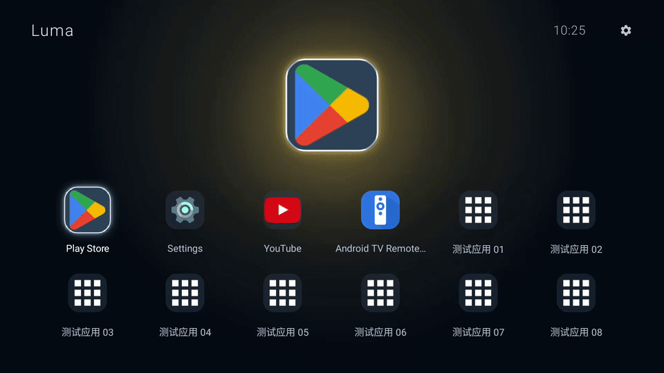
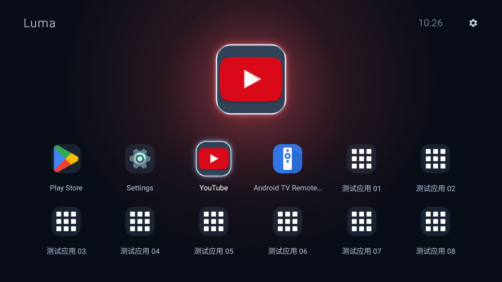
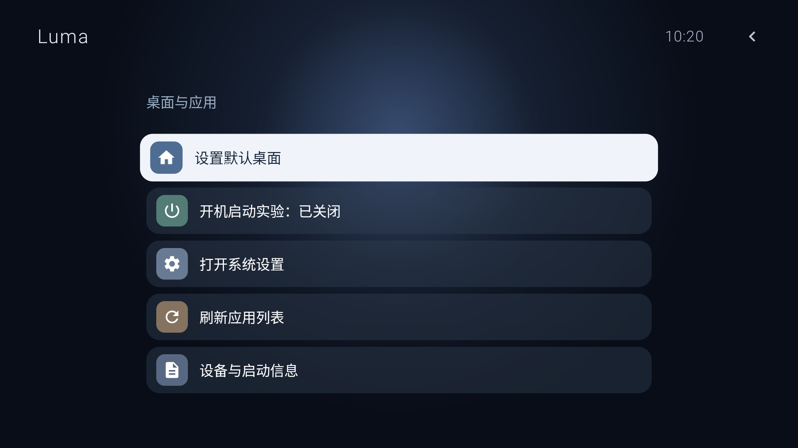

<p align="center">
  
</p>

<h1 align="center">Luma</h1>
<p align="center">A quiet home for your TV.</p>
<p align="center">原生 Android 电视桌面 · 遥控器优先 · 图标联动环境光</p>

Luma 是一个简洁的 Android 电视桌面应用。首页展示常用应用，选中图标时，周围的环境光会随应用主色柔和变化。没有内容推荐流、广告 SDK 或统计服务，也不申请联网权限。

当前版本：**0.4.0**。目标适配设备为小米电视 5 Pro 55 英寸；目前已完成 Android TV 模拟器验证，尚未完成该型号的实机适配验证。

## 预览

以下为模拟器真实录屏。画面中的“测试应用”仅用于验证大量收藏，不包含在 Luma 安装包中。



<details>
<summary>查看首页与设置页截图</summary>




</details>

## 功能

- **收藏首页**：六列网格，上下左右移动焦点，一屏显示两行，跨行时按完整行定位。
- **固定图标预览**：选中应用的大图标居中显示，收藏区域单独滚动。
- **联动环境光**：提取图标主色，约 620ms 平滑过渡；空闲时不持续运行动画。
- **柔光焦点**：选中图标放大、柔光高亮；顶部采用无框设置和返回图标。
- **应用发现**：读取已安装应用，优先使用 TV 启动入口，同一应用按包去重。
- **收藏管理**：长按添加、移除或调整顺序；本地保存，重启应用后保留。
- **设备信息**：查看 Android/API 版本、处理器架构、默认桌面及启动检测记录。
- **桌面与开机实验**：提供系统默认桌面设置入口，以及默认关闭的开机启动实验。

Luma 本身不提供视频、直播源、音乐或其他第三方应用内容。

## 开发环境

| 项目 | 配置 |
| --- | --- |
| 开发语言 / UI | Java / 原生 Android Views |
| 最低系统 | Android 6.0，API 23 |
| compileSdk / targetSdk | 35 / 35 |
| Android Gradle Plugin | 8.7.3 |
| Gradle Wrapper | 8.10.2 |
| JDK | 17 或 21（已使用 21 验证） |
| 应用包名 | `com.jianping.tv` |

包名保留早期版本的命名，以便同签名覆盖升级并继续使用现有收藏数据。项目没有原生二进制依赖，不限定 ARM 32/64 位架构。

## 本地构建

1. 克隆仓库：

   ```sh
   git clone git@github.com:mfcheer/luma.git
   cd luma
   ```

2. 通过 Android Studio / SDK Manager 安装 Android SDK Platform 35 和 Build Tools 35.0.0。

3. 在项目根目录创建 `local.properties`，将下方路径替换为本机实际 SDK 路径：

   ```properties
   sdk.dir=/absolute/path/to/Android/sdk
   ```

   也可以直接使用 Android Studio 打开工程，由 IDE 配置 SDK 路径。`local.properties` 不提交到仓库。

4. 构建并运行静态检查：

   ```sh
   ./gradlew :app:assembleDebug :app:lintDebug
   ```

   Windows 使用 `gradlew.bat` 执行相同任务。

产物位置：`app/build/outputs/apk/debug/app-debug.apk`。仓库不包含本机生成的 APK、Gradle 缓存或签名密钥。

## 安装与使用

可以通过电视支持的 U 盘安装入口安装 APK，也可以在开启调试并授权连接后使用 ADB：

```sh
adb connect <电视显示的地址和端口>
adb install -r app/build/outputs/apk/debug/app-debug.apk
adb shell am start -n com.jianping.tv/.ui.MainActivity
```

部分固件使用无线配对和动态端口，请以电视显示的信息为准。

| 操作 | 行为 |
| --- | --- |
| 方向键 | 移动焦点或切换收藏行 |
| 确定 | 打开应用或进入设置 |
| 长按确定 | 收藏、移除或调整排序 |
| 返回 | 从应用列表、设置返回首页 |
| Home | 由系统当前默认桌面决定 |

同一签名的后续 APK 可以覆盖升级。不同电脑生成的默认调试密钥可能不同；若需要持续分发，请自行配置并妥善保管固定签名密钥。

## 开机与默认桌面的限制

声明为桌面应用、收到开机通知，以及系统命令返回成功，均不等于系统允许它接管 Home 或开机画面。Luma 分开记录开机通知、启动请求与界面进入情况，便于实机确认。

目前的 Android TV API 33 模拟器测试中，设置默认桌面的命令曾返回成功，但 Home 仍进入系统桌面。因此 **MiTV OS 2.17.3226 上的开机自动进入、Home 接管和待机唤醒仍需实机验证**。应用不会禁用原厂桌面，也不会移除系统或第三方应用内部的广告。

更详细的安装、恢复与验证步骤见 [安装与电视验证](docs/安装与电视验证.md)。

## 项目结构

```text
app/src/main/java/com/jianping/tv/
├── data/                      应用发现、应用模型、收藏与设置持久化
├── platform/                  开机广播、设备与默认桌面检测
└── ui/
    ├── MainActivity.java      页面、遥控器焦点和导航
    ├── AmbientBackgroundView.java  主色联动环境光
    ├── IconPalette.java       图标主色采样
    ├── FocusHaloDrawable.java 缓存柔光效果
    └── FavoritesScrollView.java    完整行滚动与过渡渐隐
```

底层应用管理、收藏和设备检测与 UI 分开，后续可以继续扩展主题、布局与设置。详见 [设计与架构](docs/设计与架构.md)。

## 验证

当前已通过 APK 构建和 Android Lint，以及 Android TV API 33 ARM64 模拟器上的遥控器、28 个收藏、跨行导航、外部应用启动返回与颜色联动验证。

`scripts/` 中的自动化脚本是针对开发时的 macOS SDK 路径和专用 `emulator-5554` 编写的测试工具，需要对应模拟器和测试数据。**部分脚本会清空或替换该模拟器中的应用数据，请勿直接用于个人电视。** 大量收藏测试先使用 `emulator-fixtures.py` 安装独立的模拟器测试应用；这些应用不打包进 Luma。

- `clean-smoke.py`：当前布局的网格、顶部预览、设置、全部应用和应用启动返回。
- `emulator-fixtures.py`：创建 24 个标记为“测试应用”的模拟器应用。
- `grid-smoke.py` / `state-smoke.py` / `tv-smoke.py`：早期布局和状态验证脚本；使用前应核对当前版本的导航路径。

详细记录见 [验证记录](docs/验证记录.md)。

## 素材与第三方说明

应用标识由 ImageGen 生成。界面运行时显示的其他应用图标来自设备上已安装的应用，版权属于对应所有者。部分设置图标使用 Apache-2.0 授权的 Google Material Design Icons，详见 [第三方说明](THIRD_PARTY_NOTICES.md) 和 [图标许可证](docs/material-icons-LICENSE.txt)。
