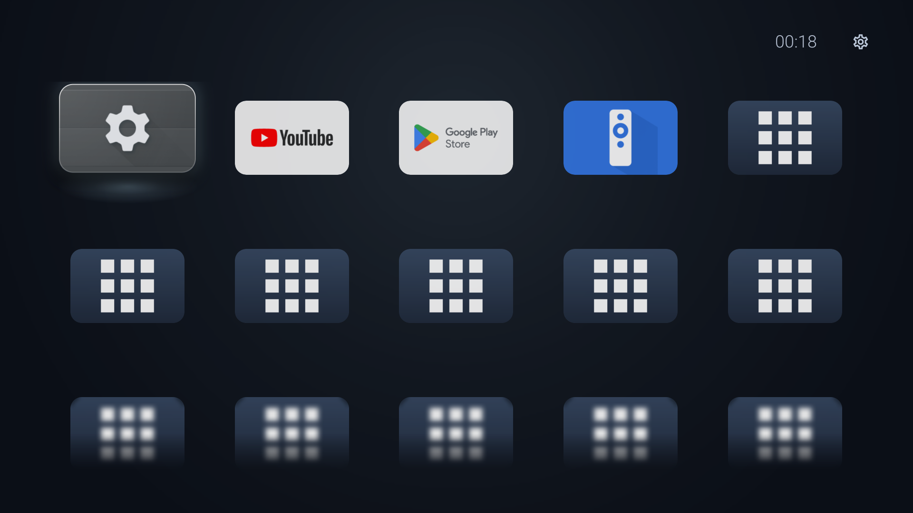
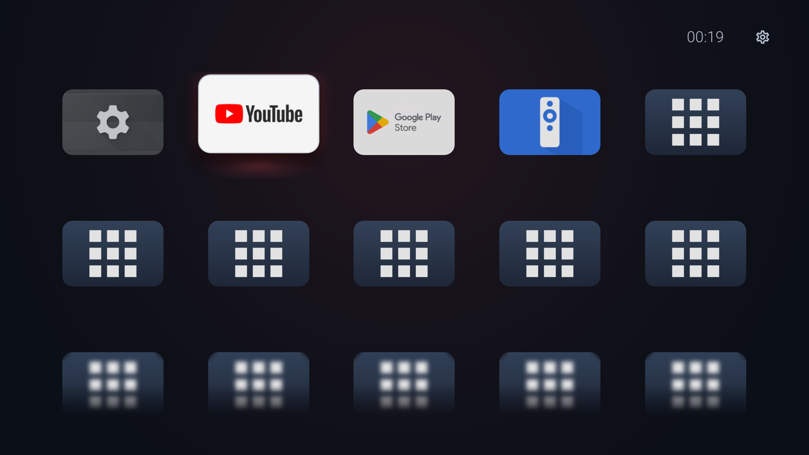
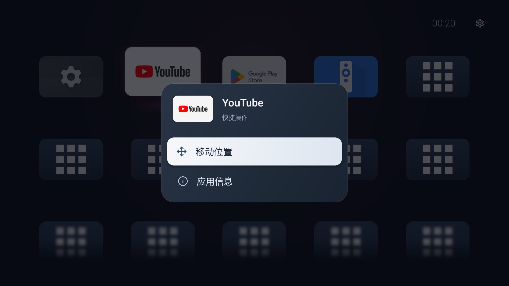
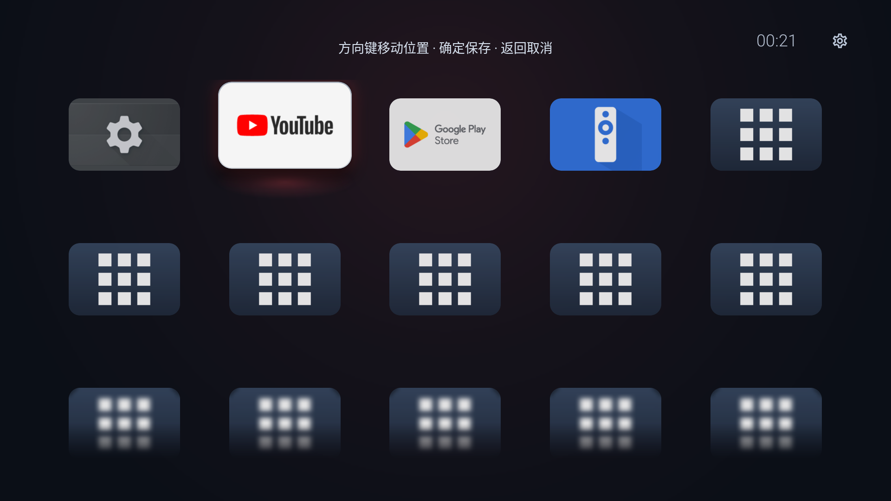
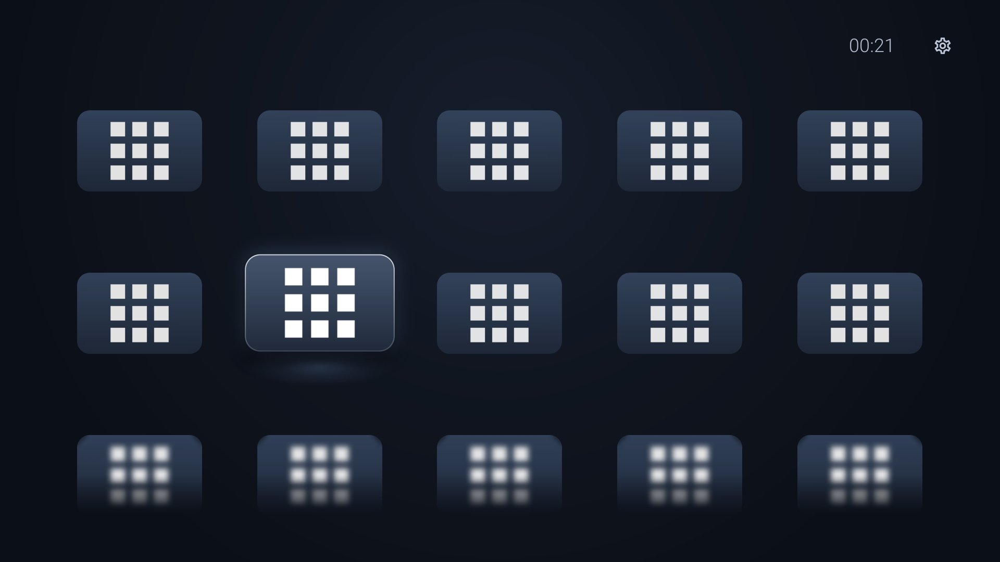

# Still 0.7.1 首页打磨审查

日期：2026-10-22。来源为本次运行的API33 Android TV模拟器，1920×1080，当前关闭首页应用名称。未修改应用代码或偏好；测试数据包含24个相同图标的测试应用，不作为真实电视的素材质量证据。

1. 首页（01-home.png）：五列与底部模糊续行清楚；焦点轮廓、明显上浮和下方光池共同强调，层次稍多。纯图标模式行间仍保留较多空间。背景广域光集中屏幕上部，当前焦点在左列。右上时钟与设置入口可见。观察限于当前显示器截图，电视远距离对比度与遥控器延迟未验证。

2. 焦点切换（02-focus.png；原始录屏导出时长4.48秒，另存缓存）：切换到白底YouTube后焦点清楚，回弹最终停止，背景变为暗红；广域光仍位于屏幕上部中央，卡片下方红色光池较明显。白底焦点与未选中白底的亮度变化突出；建议把边框、局部柔光、环境光作为一套过渡而非继续增加效果。此次记录只作为状态和运动形态证据，不测量真机帧率或输入延迟。

3. 长按菜单（03-menu.png）：两项操作明确，浅色选中行与深色背景对比清楚，未发现裁切。当前居中面板比首页更像系统对话框；“快捷操作”副标题和分隔线带来额外层级，可作为次要精简项。当前截图不能证明长名称的省略或读屏效果。

4. 进入整理（04-reorder.png）：顶部完整显示“方向键移动位置 · 确定保存 · 返回取消”，没有裁切。卡片外观与普通焦点几乎一致，缺少靠近卡片的编辑状态，可用专门抬起姿态和短“移动中”提示区分；无需持续抖动。此步未移动或保存任何位置。

5. 下翻多行（05-scroll.png）：焦点保持清晰，显示两行与下方模糊续行。滚动后没有细位置条或行位置提示，关闭名称时更难判断进度；不将测试应用相同标识认定为产品素材缺陷。边界预览模糊强度可以再减弱，优先用渐隐表达离开视口，保留轮廓。

## 建议优先级

- 优先：环境光同时跟随焦点位置和主色，采用慢而克制的位移；卡片附近的局部光和背景统一过渡。当前实现的广域光位置固定（AmbientBackgroundView），不是卡片位置驱动。
- 优先：保持明显的浮起，收敛白色轮廓与下方独立光池；连续按键立即跟随目标，停下时轻微回弹，避免把每次经过都做成完整表演。当前代码进入420ms/退出230ms/背景620ms，需要作为一套节奏校准。
- 优先：整理模式给被移动卡片独立状态，附近增加简短编辑标识，与普通焦点可见区分；确定保存、返回撤销保持。
- 随后：滚动时短暂显示细位置条，停止后隐藏；半行预览以渐隐为主、少量模糊。五列、两行半、大留白继续保留。
- 次要：长按菜单删减“快捷操作”等重复信息，统一细边、圆角和阴影；当前两项动作清楚，不需要大幅重排。

## 可达性与实机限制

图标有无障碍名称，菜单选中行有明显明暗对比；截图不能证明读屏完整性或远距离可读性。当前隐藏名称的用户选项保持不变，不能仅凭测试应用同款图标推断实际识别效果。可在设置提供可选减弱动效，保持明确的焦点边界；这属于建议，未实现。

本次未修改APP代码、未保存顺序变化，整理状态已取消。未用模拟器录屏推断电视帧率；电视的显示亮度、边缘裁切、遥控器长按重复与延迟，需要Android9实机验证。截图捕获有短暂合成延迟，04-reorder最初仍为菜单，已丢弃并在UI树确认后重新截图。录屏含较长静止段，仅作补充，不据此量化快速切换性能。

## 本次截图

### 1. 首页：结构良好，焦点材质可收敛

### 2. 左右切换：目标清楚，灯光位置联动可提升

### 3. 长按菜单：清楚可用，次要精简

### 4. 整理：操作指引完整，专属状态较弱

### 5. 多行滚动：续行正常，缺少进度提示

