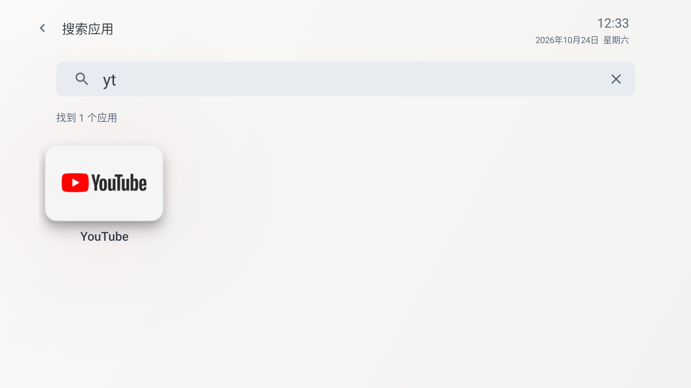
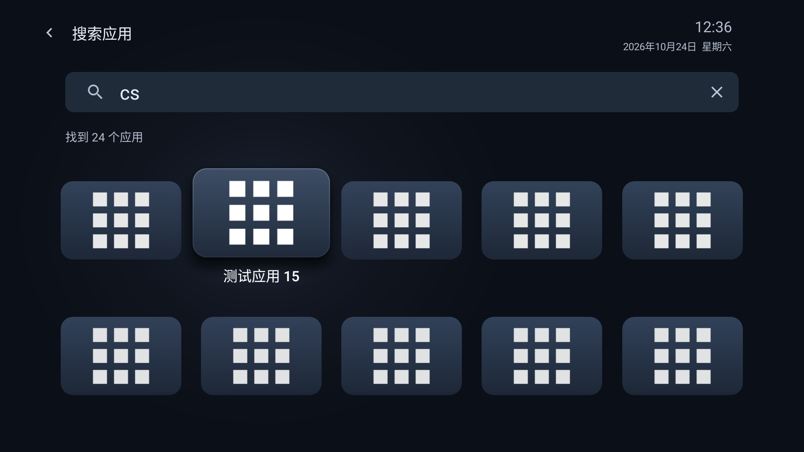

# Still 0.9.4 搜索优化

本地开发预览，versionCode22。保留0.9.3的统一自动进入功能；官网与公开下载仍为0.9.2。本版搜索界面、设置选项和首页人工顺序保持不变。

## 搜索规则

- 内置离线词库包含58个产品、61个准确包名、168个独立名称/别名词条。包括电视已装应用及常见国内/国际影音、播放器、NAS、投屏工具和游戏客户端。详见[发布覆盖表](search-coverage.md)。10个TV包名未核实的候选不发布，未知应用仍使用真实名称/拼音检索。
- 同一个应用的名称、别名、全拼、首字母只取最佳命中，不累加分数，按当前启动组件去重。不同包的同名应用分别显示真实名称和图标。
- 整词文字匹配优先，其次整词全拼/首字母，再是名称前缀、包含、拼音前缀与原名称拼音包含。同档区分原名称、审核产品名、别名、历史名；全拼优于首字母。之后才比较本地近期使用权重，再按首页顺序。
- 例如“网易云”中音乐的别名整词命中优于云游戏的名称前缀，即使云游戏更常用也不能越档。`mgtv`明确简称优先命中芒果TV；咪咕TV的首字母只作为较低档匹配。
- 缩写只做完整匹配；不会跨词条拼接搜索，也不按包名前缀、同品牌或显示名称猜测应用身份。YouTube与SmartTube、Jellyfin与Emby分别维护。
- 仅对准确包下审核过的整词纠音，例如QQ音乐的`qqyy`；不做“乐”字全局替换，“拼音乐园”的`pinyinleyuan`保持正确。

## 本地使用权重

首页和搜索页统一经过`AppLaunch.open`：只有`startActivity`成功提交后才记一次。选择图标、菜单、返回、开机/唤醒、打开系统应用信息均不计数；记录失败不能影响已经成功提交的应用启动。

每个包保存权重、时间和一项随机历史代次标识，不保存逐次事件、搜索词或观看时长。不申请全局使用记录权限，不联网、不上传。权重以14天半衰期惰性衰减，时间倒退不会放大旧分数；损坏记录安全回退。全新用户从零开始积累，无记录时按首页顺序。

每次进入搜索固定权重快照，并随Activity保存状态；从应用返回及真正后台进程死亡恢复都沿用这份快照，结果与焦点不因刚才的使用改变。下一次进入搜索才采用新的权重。真实卸载由`PACKAGE_FULLY_REMOVED`清理；覆盖更新保留。历史代次使卸载重装不会复用旧搜索会话保存的分数。

## 索引与应用变化

词库在已有搜索工作线程读取一次，已准备的单应用检索词按组件ID、名称、语言/版本指纹和词库实例复用。使用权重与图标缓存、首页偏好独立；输入和普通应用返回不会重新扫描目录或读取图标。

搜索页仅在包安装/移除/变更时后台更新目录，并保留查询和有效焦点；变更了名称/版本的卡片刷新真实内容。词库缺失、格式错误或不受支持时，退回已有名称与拼音检索。

## 验证记录

当前已完成以下验证：

| 项目 | 结果 | 记录 |
| --- | --- | --- |
| 构建与Android Lint | 通过，0错误、17项既有警告；minSdk23、targetSdk35 | `build-final.txt` |
| 匹配与本地排序规则 | 553项通过，包括每个发布词条、整词纠音、去重、撞词、准确度优先、冻结权重、损坏数据与时间异常 | `search-index-test.txt` |
| 原搜索规则 | 名称/英文/全半角/空输入/兜底通过；完整首字母优先按新协议更新预期 | `search-legacy-test.txt` |
| Android原生集成 | 12项通过：提交成功/失败、单次计数、共享持久化、冻结快照、卸载/更新、数据损坏、历史代次 | `usage-integration.txt` |
| 真实电视目录离线回放 | 41个实际启动入口，20组输入的首个结果、去重和未安装应用不出现均通过；不是Android9运行时测试 | `real-catalog-replay.txt` |
| API33双主题新功能 | 别名、频次、普通返回零目录/索引工作、实际进程死亡恢复、下一次搜索学习、真实卸载重装、首页与搜索分别计数均通过；原偏好/使用聚合/测试APK还原 | `search-smoke.json` |
| 既有搜索双主题回归 | 拼音/英文、输入焦点、键盘返回、多行结果、启动返回、实际进程死亡、清空/空结果及首页位置均通过 | `search-regression/search-smoke.json` |
| 既有长按菜单双主题回归 | 取消、焦点隔离、首页定位、置前保序、重复置前、应用信息与实际进程死亡后的首页交接均通过 | `menu-regression/search-menu-smoke.json` |
| 恢复后编辑焦点 | 真正后台进程回收后恢复搜索，再在输入框编辑期间禁用/启用测试应用；目录更新且输入焦点保持，通过 | `editing-focus-smoke.json` |

模拟器测试均还原原首页偏好、使用聚合及测试应用可用状态。本版在模拟器覆盖安装保留原有选项，未改变系统默认桌面。

搜索交互回归在专用API33电视模拟器运行。2026-10-24按用户要求向Android9/API28小米电视覆盖安装0.9.4：签名一致，安装成功，实际安装APK哈希与交付包一致；首页偏好仅启动诊断时间变化，原设置、应用顺序及默认桌面均保留。进程与自动进入服务正常运行，崩溃缓冲区为空。电视在界面检查时已息屏，未再次唤醒，因此本次不宣称完成实机搜索交互或开机/唤醒回归。详见[tv-install.json](tv-install.json)。

`AppSearchTest`的`db`预期按新协议调整：完整首字母“当贝”优先于“当贝市场/播放器”的首字母前缀，同为前缀的候选仍保留首页相对顺序。这是本轮明确的排序变化。

维护：修改审核源后运行`python3 scripts/prepare-search-aliases.py`；使用`--check`验证生成资产一致。原始草案及待核实项目继续保留在`docs/plans/search-aliases/`，不参与应用运行。

## 界面核对

浅深主题均沿用原输入框、结果计数、卡片和名称布局，没有新增别名提示或配置项。长按菜单的初始焦点改为在挂载后请求，修复特定窗口/触摸状态下只展开面板却没有选中第一项的情况；视觉样式保持。

深色画面中的重复图案是专用模拟器测试应用图标，不是实际电视应用素材，也不包含在Still中。

## 本地安装包

`output/Still-0.9.4-debug.apk` 与当前Gradle构建产物一致，已覆盖安装到专用模拟器。版本/SDK和签名见 `apk-badging.txt`、`apk-signature.txt`，最终校验和见 `apk-sha256.txt`。签名沿用既有调试签名。

已覆盖安装到真实电视，安装校验见上文；没有向官网复制新APK或发布新素材，官网实机素材保持原来源和版本说明。
