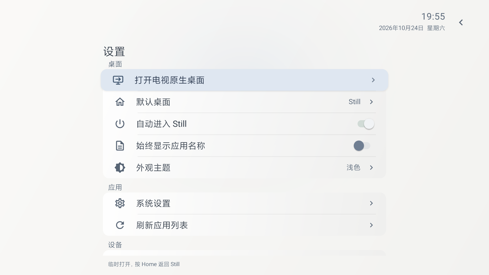
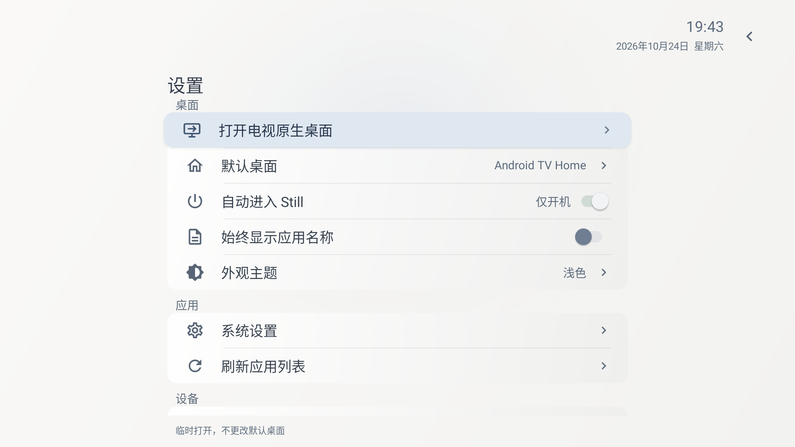
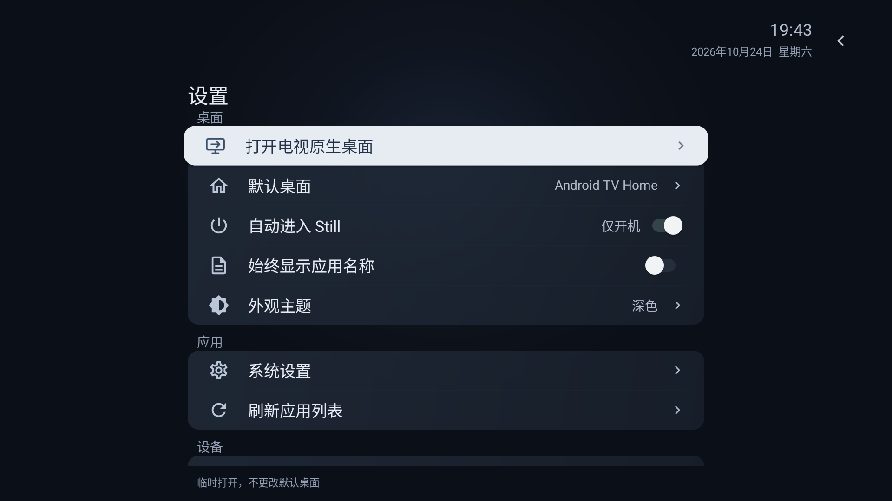

# Still 0.9.5 原生桌面快捷入口

设置页“桌面”分组第一项新增“打开电视原生桌面”，使用带进入箭头的电视图标；“默认桌面”保留房子图标。只有一个其他可用桌面时直接打开；多个时首次选择，列表初始选中第一个桌面，成功打开后记住完整组件。每次点击重新核对可用性，目标卸载/禁用后清除旧选择并重新选择；系统拒绝启动时留在Still并提示。

入口使用系统公开的HOME候选，过滤Still、系统解析器和FallbackHome，并按组件去重；不根据品牌猜测包名。若OEM将HOME组件设为受限入口，只选择同包内指向该准确HOME组件、已启用且公开导出、权限允许的activity-alias。没有合格公开别名时不显示，不请求特权。小米实机入口证据见oem-home-entry.json。不更改系统默认桌面、首页顺序、自动进入开关或使用频次。

选中入口时，在设置页底部轻提示：默认桌面检测为Still时显示“临时打开，按 Home 返回 Still”，其他情况显示“临时打开，不更改默认桌面”。移动焦点后隐藏，保持列表行高。

成功主动打开其他桌面后，取消当前已排队但尚未执行的唤醒返回及确认回调；保留开机/待机监听与下一次睡眠唤醒周期。未启动或不支持唤醒服务的系统安全忽略取消操作。

## 验证范围

构建与Android Lint通过，0错误、17项既有警告。minSdk23、targetSdk35、versionCode23、版本0.9.5，沿用既有调试签名。详见build-final.txt、apk-sha256.txt、apk-signature.txt。

原生集成16项通过，覆盖候选过滤、空/单/多入口、记忆和失效、成功/拒绝启动、默认桌面保持、待执行唤醒回调取消与下一次周期保持。

UI双主题回归通过：直接打开原桌面、Home遵循系统默认桌面、选中时轻提示、末行自动滚入可见区域、无立即返回；多入口列表首项焦点、取消、记忆直达及卸载后重新选择均通过。记录见home-integration.txt、home-smoke.json。专用模拟器使用API33；测试用桌面/探针APK不打包进Still，结束后删除并恢复原偏好与默认桌面。

## 小米 Android9 实机

2026-10-24已完成0.9.4到修正后0.9.5的同签名覆盖安装，实际安装包SHA-256与交付包一致；原应用顺序、主题、名称开关、自动进入设置、使用聚合和默认桌面均保留。详见tv-install.json。

实机发现小米HOME组件带signature权限，已根据安装包清单和系统解析结果识别其公开别名。模拟器新增“受限HOME＋公开MAIN/DEFAULT别名”测试应用，实际选择和启动通过；别名采用其公开MAIN/DEFAULT调用方式，兼容Android13的Intent过滤检查。

用户结束投屏后，Android9实机完成首次直接打开、记忆后再次直接打开、原生桌面停留4秒不立即返回、两次真实Home按键返回Still应用墙。原顺序、主题、名称开关、自动进入设置、使用聚合和默认桌面保持；没有安装测试应用。详见tv-smoke.json，实机设置截图见下方。

验证结束已回到Still首页并恢复待机，确认mWakefulness=Asleep、屏幕OFF。此次未重复开机/待机唤醒回归，不能用入口验证替代启动测试。模拟器历史上的默认桌面命令与实际Home解析可能不同，测试以实际解析和按键为准，不假设接管成功。

本地安装包：output/Still-0.9.5-debug.apk。官网公开下载及素材仍为0.9.2，本次不更新官网。

