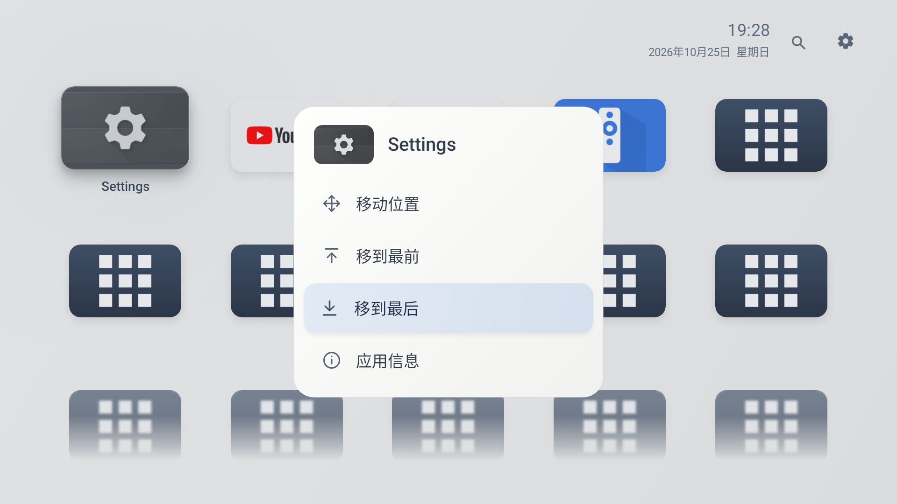
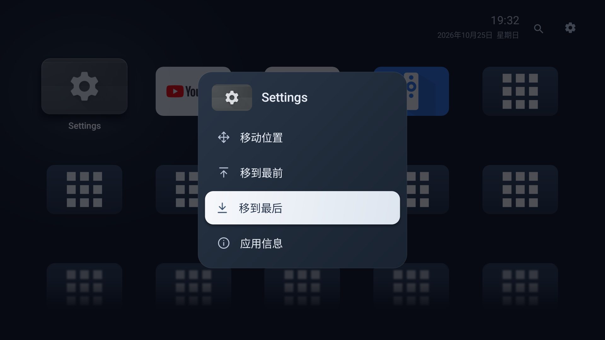
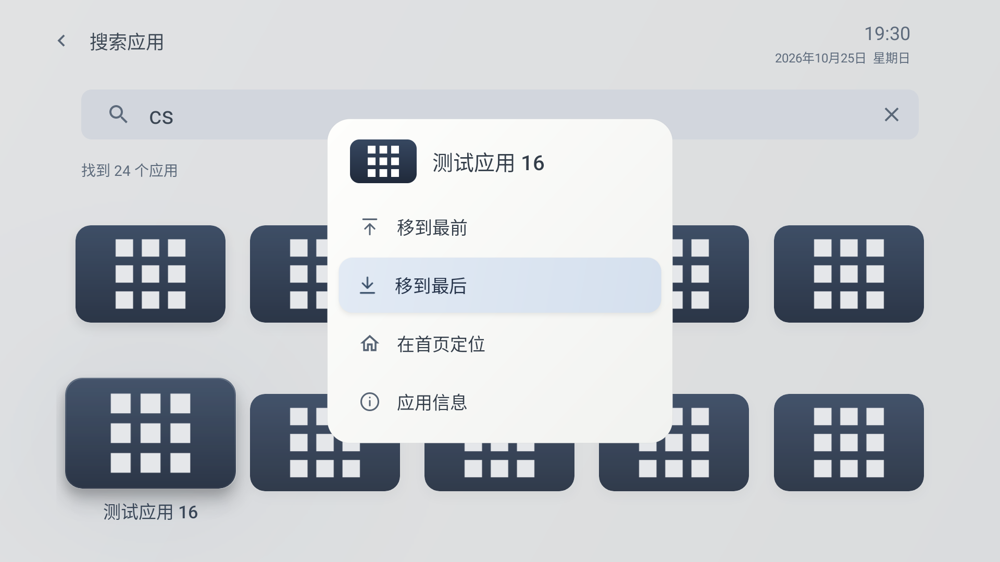
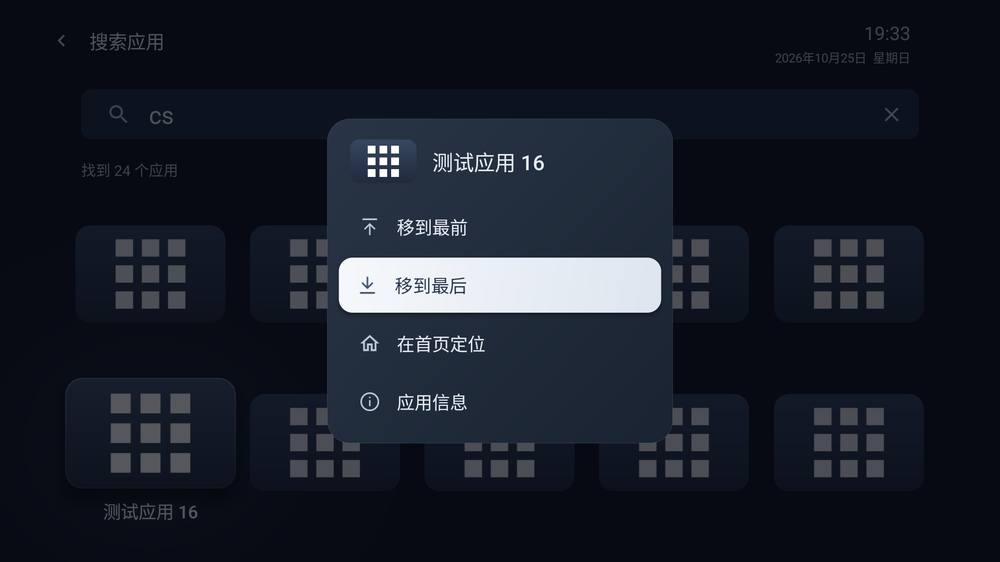

# Still 0.9.6：移到最后

首页长按菜单按“移动位置、移到最前、移到最后、应用信息”排列；搜索结果菜单按“移到最前、移到最后、在首页定位、应用信息”排列。置后图标沿用置前图标的线条与尺寸，箭头朝下指向底线；菜单沿用既有配色、焦点和弹出效果。

选择“移到最后”立即保存首页顺序，仅把目标应用放到当前列表末尾，其余应用保持相对顺序。首页焦点跟随目标滚到末尾的清晰区域；搜索保留关键词和选中应用，重新使用原会话的匹配规则与使用分数排序，返回首页可定位到目标。已经在末尾时重复执行不产生重复项，也不改变其他应用顺序。

置前与置后复用页面已有的顺序保存、焦点恢复及搜索结果交接路径。未增加权限、设置项或后台服务，也不改变新安装应用追加到末尾的规则。

## 构建与验证

- 版本0.9.6，versionCode24；最低API23、targetSdk35。
- `:app:assembleDebug :app:lintDebug`通过，Lint为0错误、17项既有警告。
- `AppOrderTest`通过：置后保留其余项相对顺序和输入列表，重复执行稳定，刷新后保序，兼容目标缺失、空列表和单应用。
- UI回归脚本：`scripts/move-last-096-smoke.py`，只针对28应用的专用API33电视模拟器，结果见`move-last-smoke.json`。
- 浅色与深色均通过首页/搜索置后、其余项保序、重复执行稳定、冷启动持久化、菜单取消、搜索关键词与焦点保留、末尾应用首页定位，以及原有置前、手动移动撤销和应用信息返回。
- 脚本退出时恢复模拟器完整原偏好，不连接或操作真实电视。

2026-10-25已从0.9.5同签名覆盖安装到小米电视5 Pro（MiTV-ANSP0 / Android9），核验安装版本0.9.6、versionCode24及实际APK哈希一致；原应用顺序、主题、名称开关、自动进入设置、记忆的原生桌面、使用记录和默认桌面均保留。安装前后保持待机息屏（Asleep / OFF），未唤醒电视或进行实机菜单交互测试，也未安装测试应用。记录见`tv-install.json`。

官网公开下载和素材仍为0.9.2，本轮未更新。

本地安装包：`output/Still-0.9.6-debug.apk`。

SHA-256：`035bf1e6d3761529387dc93e56dcd2c40a7c4ee1ec20ac503fa958ee29441b95`。

## 模拟器截图

