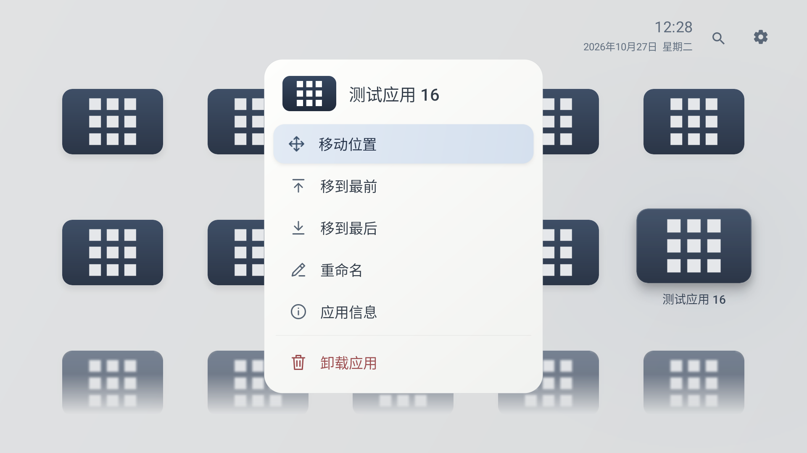
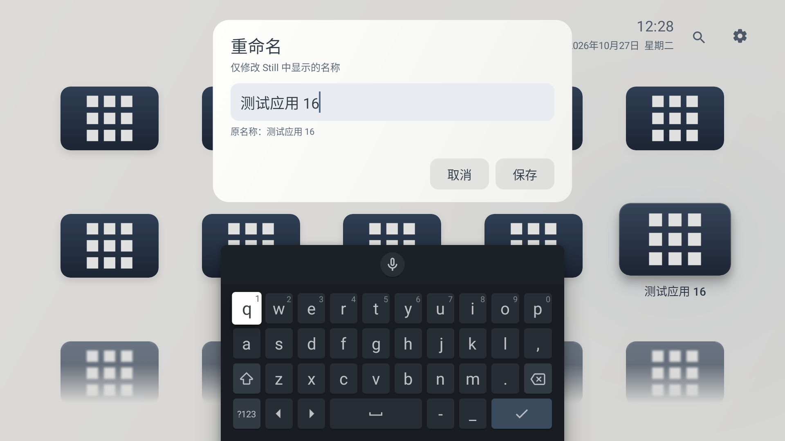
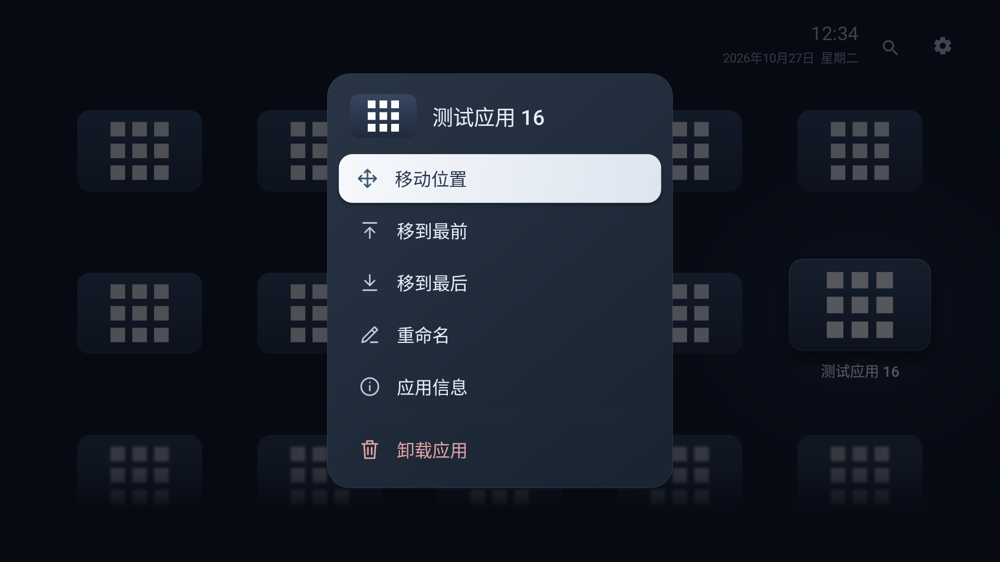
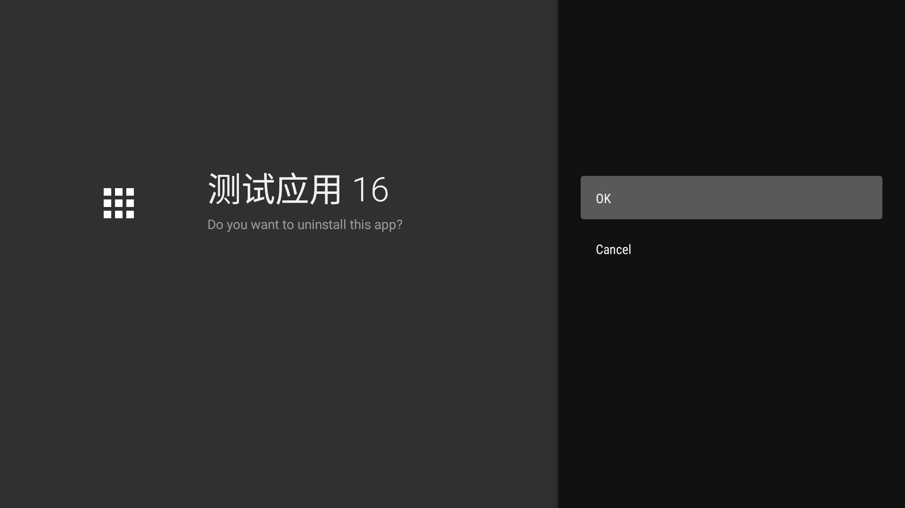

# Still 0.9.7：应用重命名与卸载

首页菜单为“移动位置、移到最前、移到最后、重命名、应用信息、卸载应用”；搜索菜单将“移动位置”替换为“在首页定位”，置于置后与重命名之间。六项同屏，原有配色和焦点效果保留，卸载项在底部以细分隔线和克制的红色区分。系统应用保留灰色禁用行与“系统应用”说明，方向键不会落到禁用行。

## 重命名

共享输入弹窗保留原名称提示，支持取消、保存与已有自定义名称时的恢复原名；输入最多30个Unicode码点，清理首尾空白并拒绝空白名称。返回键先收起键盘，再取消编辑；明确保存后才写入。

自定义名称按包名及首次安装时间保存在独立的`app_names_v1`偏好中。原始应用标签不变，名称更新不重建图标或扫描整批应用；卡片原地更新文字和无障碍名称，菜单显示自定义名称并附原名。应用升级保留自定义名称，真正卸载清理；即使卸载广播漏收，重新安装时间不匹配也不会沿用旧名字。

搜索索引同时保留原名、新名和现有品牌别名，新名称与原名按相同优先级匹配，仍支持拼音和首字母。同名命中去重，准确度、冻结的使用频次与首页手动顺序规则不变。改名仅重建受影响的文本条目；保留查询与目标，目标不再匹配时选择相邻结果，无结果时回到输入框。

## 卸载

通过`ACTION_UNINSTALL_PACKAGE`和普通`REQUEST_DELETE_PACKAGES`权限请求系统确认，不执行静默删除或ADB卸载。每次请求前核验目标仍安装、安装代次一致且非系统/当前桌面应用；系统拒绝或缺少入口时保留图标并提示。

搜索目录的待刷新状态不会被名称刷新或页面恢复降级，直到有效的最新扫描被接收才清除；取消的扫描不会提交空目录，未完成刷新和卸载请求随Activity恢复。系统返回结果码不是移除依据。通过包变更广播、实际安装状态和目录刷新同步界面；确认移除后才清理名称、使用记录和顺序。取消保留查询与焦点，移除后保留相邻位置；删除末项则选择前一项，空搜索结果聚焦输入框。待卸载包名随Activity状态保存，进程恢复后仍按实际状态处理；不会把旧的“在首页定位”目标重新指向已卸载应用。

## 验证记录

- 版本0.9.7，versionCode25，minSdk23、targetSdk35。
- 构建与Android Lint通过，0错误、17项既有警告。
- `AppManagementProbe`原生集成45项通过，覆盖名称校验、持久化、APK更新/重新安装、旧目录缓存、原名/别名/拼音、新名称索引失效、相邻焦点、卸载返回与名称刷新竞争、系统应用本地改名与卸载保护、准确的系统卸载请求和卸载广播清理。结果见`management-integration.txt`。
- 原有中文/英文/拼音搜索、553项词库与排序规则、应用顺序校验通过，见`unit-checks.txt`。
- UI流程由`scripts/app-management-097-smoke.py`在专用API33电视模拟器验证；最终APK使用`--uninstall-only`复测浅深主题卸载、搜索改名及焦点恢复，成功结果写入`management-smoke.json`，初版完整名称/键盘流程见`management-smoke-light.txt`和本目录画面；修复前深色卸载补跑结果保留在`management-smoke-before-refresh-fix.json`。使用24个专用测试应用，卸载后重新安装，并恢复完整原顺序、设置、名称与使用记录。测试工具不打包进Still，也不连接个人电视。

本轮没有唤醒、安装或修改小米电视，电视版本仍为0.9.6；官网公开APK更新为0.9.7，实机截图和视频保留0.9.2。不能用模拟器结果代替小米Android9输入法与系统卸载窗口的实机验证。

## 模拟器画面









## 公开下载

官网提供`website/downloads/Still-0.9.7.apk`，与本次回归的构建逐字节一致；保留旧版下载。大小662,675字节，SHA-256：

```text
ed61c3a197c4d93055d81556c986668db7c6316f6e290631d86088f1d1e7c9ac
```

官网按钮、安装说明中的版本/大小、README下载入口与`SHA256SUMS.txt`同步更新。本地HTTP下载与本轮回归APK逐字节一致，全部历史下载包校验和通过，记录见`website-download-smoke.json`；0.9.7与此前公开0.9.2使用同一签名证书，可覆盖更新。
